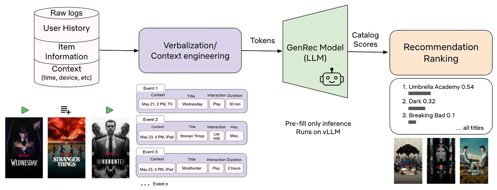
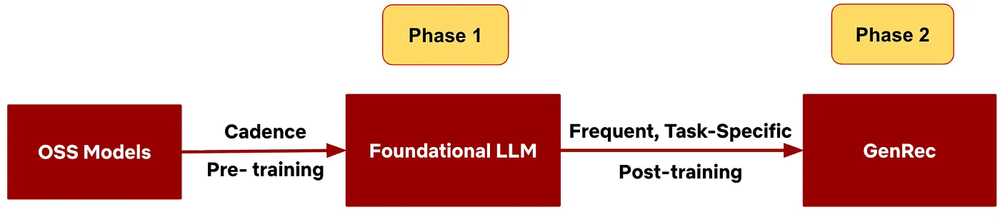
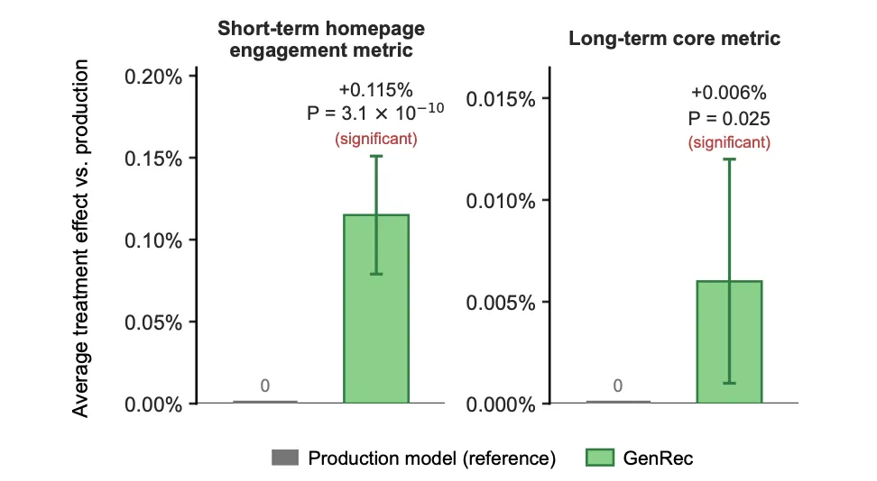
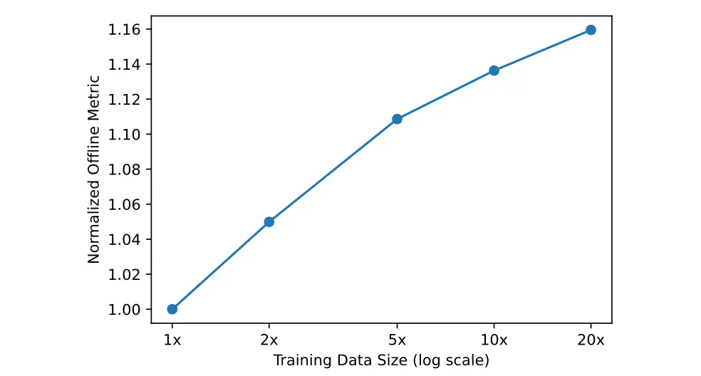
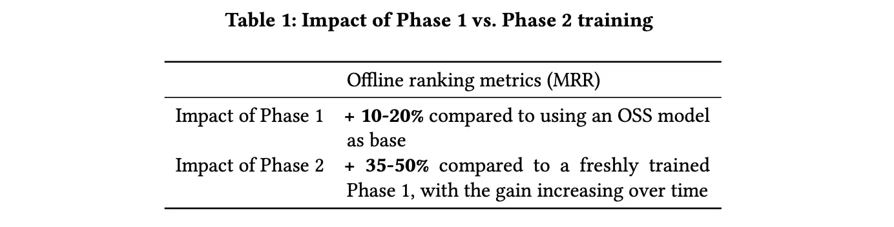
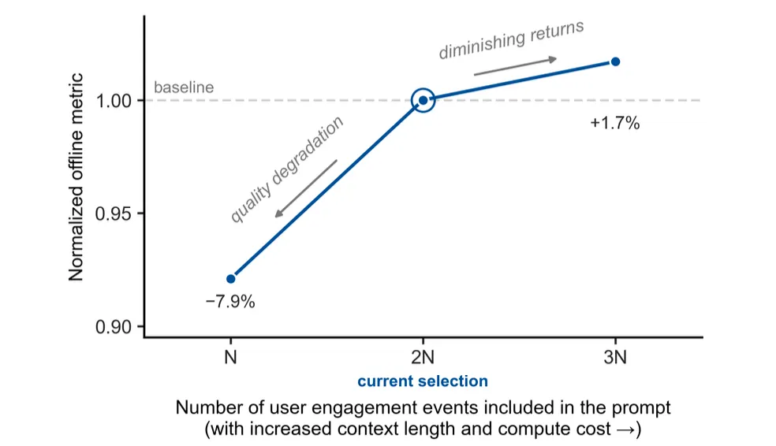

[원문 링크](https://netflixtechblog.com/genrec-towards-llm-native-recommendation-at-netflix-f20be6f643e3)

## Introduction

Netflix 경험의 중심에는 추천이 있습니다. 현재 저희의 프로덕션 모델은 사용자·아이템·인터랙션에 대해 수작업으로 설계한(hand-crafted) 수천 개의 피처에 의존하며, 여기에 시퀀스 모델링, 피처 인터랙션, 멀티태스크 목적 함수를 위한 특화 아키텍처가 더해져 있습니다. 
이 스택은 다양한 콘텐츠 유형(영화, 시리즈, 게임, 라이브, 팟캐스트)과 *프로덕트 서피스*를 지원하기 위해 여러 해에 걸쳐 발전해 왔지만, 그만큼 복잡해져서 새로운 유스케이스를 온보딩하는 비용이 큽니다. 콘텐츠 유형이나 서피스를 하나 추가하는 데에도 상당한 피처 엔지니어링, 아키텍처 변경, 인프라 작업, 실험이 필요할 수 있습니다.

> product surface: 사용자가 실제로 추천 결과를 마주하는 화면 위의 자리. 
> 서피스마다 사용자의 의도와 맥락이 다르기 때문에 좋은 추천의 기준도 달라진다.

한편 [PLUM](https://arxiv.org/abs/2510.07784), [GLIDE](https://arxiv.org/abs/2603.17540), [OneRec-Think](https://arxiv.org/abs/2510.11639) 같은 최근 연구에서 보듯, 대규모 언어 모델(LLM)은 추천을 바라보는 관점을 바꾸고 있습니다. 
LLM이 지닌 폭넓은 일반 지식(world knowledge)과 뛰어난 언어 이해 능력 덕분에, 사용자 이력과 아이템 메타데이터를 텍스트로 직접 표현하고, 공유된 의미 공간(semantic space) 안에서 풍부한 관계를 포착하며, 자연어 프롬프트로 추천 방향을 조정(steer)할 수 있게 되었습니다. 
그러나 기성(off-the-shelf) LLM은 아직 프로덕션에서 쓸 만한 추천 모델과는 거리가 멉니다. 누구에게나 인기 있는 콘텐츠를 과도하게 추천하고, 카탈로그에 존재하지 않는 아이템을 지어내고(hallucination), 비즈니스 제약을 무시하며, 개인화 수준도 제한적인 경우가 많습니다.

이 문제를 해결하기 위해 저희는 GenRec을 만들었습니다. GenRec은 사내 파운데이션 LLM을 Netflix 고유의 데이터와 목적 함수로 포스트 트레이닝한 LLM 기반 추천 랭커입니다. 
GenRec은 LLM 기반 랭커가 훨씬 적은 레이블 데이터와 입력 신호만으로도, 오랜 기간 고도화된 프로덕션 시스템에 필적하거나 이를 능가하는 성능을 낼 수 있음을 보여줍니다.

[그림 1: GenRec 파이프라인] 사용자 이력, 아이템 메타데이터, 컨텍스트의 원시 로그(raw log)를 컨텍스트 엔지니어링을 거쳐 자연어 프롬프트로 변환한 뒤 GenRec에 입력합니다. 
GenRec은 vLLM 위에서 프리필 전용(prefill-only) 모드로 실행되며, 카탈로그의 각 아이템에 대한 점수를 출력해 추천 순위를 만들어냅니다.

큰 틀에서 GenRec은 다음과 같이 동작합니다.

- 사용자 이력, 아이템 메타데이터, 컨텍스트를 텍스트로 언어화(verbalize)합니다.
- Netflix에 맞게 적응시킨 파운데이션 LLM을 랭킹 용도로 포스트 트레이닝합니다.
- Netflix 작품 전체에 대해 카탈로그를 반영하는(catalog-aware) 스코어링 헤드를 추가합니다.
- 보상 신호(reward signal)를 활용해 회원의 장기적 가치와 비즈니스 목표에 정렬(align)시킵니다.
- 비용 효율을 위해 Netflix의 LLM 서빙 스택 위에서 프리필 전용 모드로 실행합니다.

잘 튜닝된 프로덕션 랭커를 상대로 진행한 대규모 A/B 테스트에서, GenRec은 Phase-2 레이블 데이터와 입력 신호의 극히 일부만 사용하고도 단기 및 장기 온라인 지표 모두에서 통계적으로 유의미한 개선을 달성했습니다. 
GenRec은 수작업으로 설계한 피처에 대한 의존도를 줄이고, 초점을 **피처 엔지니어링(feature engineering)**에서 **컨텍스트 엔지니어링(context engineering)** 으로 옮깁니다. 
이 글에서는 GenRec이 어떻게 동작하고 어떤 성능을 내는지, 그리고 이것이 왜 Netflix 추천의 미래가 LLM 중심으로 나아갈 것임을 보여준다고 생각하는지 설명하겠습니다.

## Problem Setting

저희는 전체 카탈로그 랭킹(full-catalog ranking) 과제에 초점을 맞춥니다(후보 집합이 주어지는 경우에는 top-K 랭킹이 됩니다).

사용자 $u$, 그 사용자의 인터랙션 이력 $H$, 그리고 현재 컨텍스트 $\tau$(기기, surface, locale, 시간 등)가 주어지면, GenRec은 각 아이템에 점수를 매겨 개인화된 순위를 만들어냅니다. 
이 순위는 그대로 추천에 쓰일 수도 있고, 후속(downstream) 개인화 시스템의 입력으로 활용될 수도 있습니다.

형식적으로 표현하면, 요청 $(u, \tau, t, H)$ — 즉 사용자, 컨텍스트, 시간, 이력 — 을 카탈로그 $C$에 대한 순위 $\pi$ 로 사상(mapping)합니다. 
여기서 $\pi(i)$는 아이템 $i$에 배정된 순위입니다. 
저희는 단기적인 참여(engagement)만이 아니라 **기대 장기 회원 효용(expected long-term member utility)** — 만족도와 리텐션의 대리 지표(proxy) — 을 기준으로 $\pi$를 최적화합니다.

## 파운데이션 LLM에서 추천 랭커로 (From Foundation LLM to Recommendation Ranker)

GenRec은 2단계 학습 프레임워크를 따릅니다(그림 2).

[**그림 2: 2단계 프레임워크.**] Phase 1에서는 사용자와 콘텐츠 이해를 위해 Netflix 데이터로 파운데이션 LLM을 학습시키고, Phase 2에서는 랭킹 전용 데이터와 목적 함수로 포스트 트레이닝합니다.

### Phase 1 - Netflix에 특화된 파운데이션 LLM

저희는 오픈소스 LLM에서 출발해, 이를 Netflix 자체 코퍼스(corpus)에 맞게 추가 학습시킵니다. 이 과정에서 모델은 다음과 같은 기초 역량을 익힙니다.

- Netflix 콘텐츠에 대한 이해
- 회원의 행동 및 선호 패턴
- 일반적인 언어 이해와 생성 능력

Phase 1은 비교적 드물게 갱신되며, Netflix에 특화된 공용 백본으로서 여러 애플리케이션에서 함께 사용됩니다.

### Phase 2 - GenRec

이어서 이 파운데이션 모델을 **랭킹 전용 데이터**와 **목적 함수**로 포스트 트레이닝해 **고품질 랭킹 모델**로 만듭니다. Phase 2의 특징은 다음과 같습니다.

- 랭킹 품질과 조정(steering)에 초점을 맞춥니다.
- 보상 가중 손실(reward-weighted loss)을 통해 여러 보상 신호를 반영합니다.
- 새 콘텐츠와 변화하는 취향을 따라가기 위해 더 자주 갱신됩니다.
- 서빙 비용 제약 아래에서 명시적으로 최적화됩니다.

## 대화 형태의 학습 데이터 (Training Data as Conversations)

Netflix 회원들은 여러 서피스에 걸쳐 수천억 건의 인터랙션 이벤트(조회, 재생, 시청 시간, 좋아요/싫어요, 찜하기, 중도 이탈 등)를 만들어냅니다. 
저희는 이 로그 데이터를 사용자와 추천 시스템 사이의 단일 턴 또는 다중 턴 "대화"로 변환합니다. 각 턴은 다음으로 구성됩니다.

- **사용자 메시지(User message)**: 언어화된 컨텍스트, 프로필, 이력, 아이템 메타데이터, 그리고 과제(예: 사용자가 다음에 무엇을 시청하거나 평가할지 추천하라)
- **어시스턴트 메시지(Assistant message)**: 회원의 실제 참여 행동(예: 어떤 작품을 얼마나 오래 재생했는지, 어떤 피드백을 남겼는지)

Phase 2 **학습** 과정에서 LLM은 **어시스턴트 메시지가 사용자 메시지에 어떻게 의존하는지** 를 학습 합니다. 
이를 통해 풍부한 추천 신호를 텍스트로 표현할 수 있고, 언어 모델링(LM) 목적 함수와 랭킹 목적 함수를 동시에 뒷받침할 수 있습니다.

**추론** 시에는 언어화된 컨텍스트를 입력하고 **카탈로그 반영 스코어링 헤드(catalog-aware scoring head)를 적용**해 아이템 순위를 매깁니다. 어시스턴트 메시지를 디코딩하지는 않습니다. 
대화 형식은 주로 학습 단계에서 LM 목적 함수를 뒷받침하고, 언어화된 텍스트에 대한 강한 언어 이해력을 유지하기 위해 사용됩니다.

> **학습 때는 대화 형식**을 그대로 써서 두 가지를 동시에 학습한다. 
> 1. 어시스턴트 메시지를 다음 토큰 예측으로 생성하는 LM 목적 함수
> 2. 카탈로그 전체에 점수를 매기는 랭킹 목적 함수
> **추론 때**는 어시스턴트 메시지를 생성하지 않는다. 사용자 메시지(언어화된 컨텍스트)만 읽어 들인 뒤 스코어링 헤드로 바로 점수를 뽑는다.

## 언어화와 컨텍스트 엔지니어링 (Verbalization and Context Engineering)

전통적인 추천 시스템은 밀집(dense) 피처와 임베딩을 다룹니다. GenRec은 다른 길을 택합니다. 
풍부한 사용자 이력과 컨텍스트를 자연어로 언어화(verbalize)해서, 원시 인터랙션 신호를 LLM의 의미 공간에 직접 인코딩합니다. 
아이템 간 관계나 변화하는 사용자 관심사 같은 상위 수준의 패턴도 수작업 피처 엔지니어링 대신 모델이 스스로 찾아내도록 맡기는 것입니다.

사용자 이력의 모든 인터랙션을 그대로 언어화하면 토큰 예산을 금방 넘어서고, Netflix 규모에서는 비용이 감당하기 어려워집니다. 
컨텍스트 윈도가 곧 "피처 예산"이 된 셈이라, 저희는 [컨텍스트 엔지니어링](https://www.anthropic.com/engineering/effective-context-engineering-for-ai-agents)을 적용합니다.

- **전부 유지**: 신호가 강한 참여 행동(예: 긴 시청, 좋아요)은 세부 정보까지 빠짐없이 적습니다.
- **생략**: 신호가 약한 이벤트(예: 아주 짧은 재생, 잠깐 스쳐 간 커서)는 뺍니다.
- **요약 또는 압축**: 반복적인 행동(예: 정주행(binge-watching))은 묶어서 줄입니다.
- **선택적 상세화**: 중요한 아이템이나 콜드 스타트 아이템(예: 신작)은 더 자세히 적습니다.

고정된 토큰 예산 안에서 최근의 강한 신호를 우선하고, 오래된 이력은 압축하거나 버립니다. 또한 프롬프트의 공통 접두부를 최대한 길게 잡아 프리픽스 캐싱(prefix caching) 효율을 높입니다. 목표는 과도한 비용 없이 랭킹 품질을 유지하는, 짧지만 정보 밀도가 높은 프롬프트입니다.

## 목적 함수: 랭킹, 언어, 보상 (Objectives: Ranking, Language, and Rewards)

GenRec 모델 전체는 추천 랭킹 목적 함수, 언어 모델링 목적 함수, 그리고 보상 가중 학습을 통한 정렬(alignment)을 결합한 **다중 목적 손실(multi-objective loss)** 로 학습됩니다.

### 1. 카탈로그 반영 랭킹 목적 함수(Catalog‑Aware Ranking Objective)

핵심 과제는 참여의 질(engagement quality)에 따라 아이템에 점수를 매기도록 모델을 가르치는 **랭킹 목적 함수** 입니다. 
가치가 높은 참여 행동(예: 충분히 긴 시청, 명확한 명시적 피드백)을 임계값과 노이즈 제거 로직을 거쳐 정답(positive)으로 레이블링하고, 언어화된 컨텍스트가 주어졌을 때 이 정답들에 더 높은 점수를 주도록 카탈로그 또는 후보 집합에 대한 교차 엔트로피 손실(cross-entropy loss)로 모델을 학습시킵니다.

### 2. 언어 모델링 목적 함수(Language Modeling Objective)

언어화된 입력과 출력에 대한 **언어 모델링(LM)** 목적 함수도 함께 유지합니다. 이는 모델의 일반적인 언어 이해력을 보존하고, 풍부한 자연어 이력과 아이템 메타데이터를 해석하는 능력을 끌어올리며, 추천 이유 설명 같은 텍스트 생성 유스케이스로 확장할 여지를 남겨 둡니다.

### 3. 정렬을 위한 보상 가중 손실(Reward‑Weighted Loss for Alignment)

단순한 랭킹 정확도를 넘어, GenRec은 (1) 영화, 시리즈, 게임, 라이브, 팟캐스트 사이의 균형 같은 비즈니스 요구 사항을 지켜야 하고, (2) 당장의 클릭이나 재생이 아니라 회원의 장기적 만족을 최적화해야 합니다.

원시(raw) 인터랙션 시퀀스만으로 학습하면 정주행을 과도하게 선호하거나 한 가지 콘텐츠 유형에 치우치는 등 바람직하지 않은 행동이 나타날 수 있습니다. 
이를 해결하기 위해 별도의 [보상 모델](https://dl.acm.org/doi/abs/10.1145/3604915.3608873)에서 얻은 신호로 랭킹 손실에 가중치를 줍니다. 
각 학습 예시는 두 종류의 신호에서 도출된 **스칼라 가중치**를 하나씩 받습니다.

- **장기 만족도 대리 지표**: 단기 참여 행동이 재방문, 카탈로그 탐색, 지속적 참여 같은 장기적 결과에 얼마나 기여하는지를 추정합니다.
- **행동 재조정**: 콘텐츠 유형과 출시 단계에 따라(예: 게임 대 영화, 신작 대 스테디셀러) 행동을 조정해 비즈니스 목표에 더 잘 맞춥니다.

그런 다음 각 예시의 랭킹 손실을 이 가중치로 조정합니다. 가치가 높은 참여 행동은 더 큰 가중치를 받고, 가치가 낮은 행동은 가중치가 낮아집니다. 
이 보상 가중 방식은 본격적인 강화학습보다 단순하고 비용 효율적이면서도 실전에서 효과적인 정렬을 제공합니다. 
GRPO 같은 강화학습 계열 방법에서 추가 이득을 확인하긴 했지만, 비용이 더 높아 향후 과제로 남겨 두었습니다.

> "GRPO"는 Group Relative Policy Optimization의 약자로, DeepSeek가 제안한 강화학습 방법이다.

## 모델 아키텍처와 서빙 (Model Architecture and Serving)

### 백본과 스코어링 헤드(Backbone and Scoring Head)

GenRec의 아키텍처는 저희 파운데이션 LLM과 거의 같습니다. 다음 토큰 예측 방식의 목적 함수로 학습한 디코더 전용(decoder-only) 트랜스포머에, Netflix 카탈로그 안의 아이템에만 점수를 매기는 카탈로그 한정 랭킹 헤드를 덧붙인 구조입니다. 
점수를 내는 과정은 다음과 같습니다.

1. **언어화(Verbalization)**: 언어화기(verbalizer) $V$가 사용자 이력 $H$, 컨텍스트 $\tau$, 관련 아이템 메타데이터를 하나의 텍스트 시퀀스 $x$로 직렬화합니다.
2. **풀링된 표현(Pooled representation)**: LLM이 $x$를 처리하면, 사용자의 현재 선호와 컨텍스트를 요약한 풀링된 은닉 상태(pooled hidden state) $h$를 추출합니다.
3. **카탈로그 반영 스코어링(Catalog-aware scoring)**: 카탈로그의 각 아이템 $i$에는 학습된 임베딩 $e_{i}$가 있습니다. 스코어링 헤드 $\phi$가 $h$와 $e_{i}$를 결합해(예: 내적 또는 작은 MLP) 점수 $s_{i}$를 냅니다. 점수에 소프트맥스를 적용하면 확률 분포가 나오고, 이를 순위 $\pi$로 변환합니다.

백본, 스코어링 헤드, 아이템 임베딩까지 모든 파라미터는 함께 학습됩니다. 
카탈로그가 매우 클 때는 효율적인 학습과 추론을 위해 샘플링된 소프트맥스(sampled softmax)나 후보 집합을 쓸 수 있습니다. 이 아키텍처는 추천을 Netflix 카탈로그 안으로 제한하면서도, 큰 후보 집합에 대해 효율적으로 점수를 매길 수 있게 해줍니다.

### 서빙과 비용 최적화

GenRec은 vLLM을 사용해 [Netflix 사내 LLM 스택](https://netflixtechblog.com/in-house-llm-serving-at-netflix-a5a8e799ea2c) 위에서 서빙됩니다. 
Netflix 규모에서 서빙 비용을 좌우하는 것은 주로 1) 모델 크기, 2) 컨텍스트 길이, 3) 추론 방식(프리필 대 자기회귀 디코딩) 세 가지입니다. 
저희는 세 가지 전략으로 비용을 통제합니다.

- **더 작거나 증류된 모델**: 더 작거나 증류(distill)된 파운데이션 모델 위에 GenRec을 학습시키되, 데이터셋은 더 크거나 더 목적에 맞게 구성하는 경우가 많습니다. 이렇게 하면 큰 모델 품질의 대부분을 더 낮은 서빙 비용으로 확보할 수 있습니다.
- **공격적인 컨텍스트 압축**: 앞서 설명한 컨텍스트 엔지니어링으로 랭킹 품질을 유지하면서 토큰 수를 최소화합니다.
- **프리필 전용 추론(Prefill only interence)**: 큰 후보 집합에 대해 자기회귀 디코딩을 하면 비용이 감당할 수 없을 만큼 커집니다. 대신 프리필 전용 모드로 실행합니다. 모델이 프롬프트를 한 번만 읽고, 단 한 번의 순전파(forward pass)로 후보 집합 전체에 점수를 매기며, 토큰을 하나씩 생성하는 과정은 없습니다.

이 선택들이 합쳐져, 컴퓨팅 예산 안에서 대용량 워크로드에 GenRec을 서빙하는 일이 가능해집니다.

## 오프라인 및 온라인 실험 (Offline and Online Experiments)

저희는 여러 해에 걸쳐 튜닝해 온 성숙한 기존 프로덕션 랭커를 기준선(baseline)으로 삼아 GenRec을 평가했습니다. 기준선 모델은 수천 개의 공들여 설계한 밀집 피처(dense feature)와 임베딩 피처에 의존하며, 피처 상호작용과 시퀀스를 모델링하기 위한 커스텀 아키텍처를 갖추고 있습니다. 
성능은 오프라인 평가 지표와 대규모 온라인 A/B 테스트 양쪽으로 측정했습니다.

### GenRec 대 기존 프로덕션 모델(Production Baseline)

**오프라인**에서 GenRec은 훨씬 적은 입력 신호와 레이블 데이터만 쓰고도 랭킹 지표에서 프로덕션 랭커를 앞섰습니다. 
Phase 2 레이블 학습 데이터를 약 40분의 1만 사용하고도 MRR(Mean Reciprocal Rank, 평균 역순위)이 약 +1.6% 개선되었습니다. 
Phase 2 학습 데이터를 늘리고 입력 신호를 풍부하게 할수록 GenRec의 오프라인 지표는 계속 좋아졌습니다.

**온라인**에서는 **배치 컴퓨팅 기반 추천 서피스**를 대상으로 약 4주간 Netflix 트래픽의 약 10%를 포함하는 대규모 A/B 테스트를 진행했습니다. 데이터도 신호도 적은 이 구성에서 GenRec은 단기 및 장기 온라인 지표 모두에서 프로덕션 기준선 대비 통계적으로 유의미한 개선을 보였습니다(그림 3).

> 배치 컴퓨팅 기반 추천 서피스(batch-compute recommendation surface)
> 배치 컴퓨팅(오프라인 방식)은 사용자가 오기 전에 미리 추천 결과를 계산해두는 방식이다.
> LLM 추론은 전통 모델보다 훨씬 무겁다. 서빙 최적화를 하더라도 수억 명에게 실시간으로 수백 밀리초 안에 응답하는 것은 부담이다.
> 배치 방식은 지연 시각 제약이 없고, GPU를 한꺼번에 몰아서 써서 효율이 높다.
> vLLM 같은 서빙 엔진은 큰 배치에서 처리량이 가장 좋다.
> 또한 실패해도 전날 결과를 그대로 쓰면 되므로 장애 위험이 낮다.
> 다만 배치로 계산하기 때문에, 컨텍스트 $\tau$ 의 일부가 빠질 것이다.
> 이를테면 GenRec 입력에는 (기기, 서피스, 시간) 같은 현재 컨텍스트가 들어간다고 언급했는데, 밤에 미리 계산하는 경우, "내일 이 사람이 TV로 볼 지 폰으로 볼 지, 혹은 아침일지 저녁일지" 모른다.
> 따라서 batch surface에서는 컨텍스트를 대푯값으로 넣거나, 기기별 여러 벌을 만들어두어야 한다.

이 결과는 적절히 포스트 트레이닝하고 정렬한 LLM 기반 랭커가 전통적인 추천 모델의 강력한 대안이 될 수 있으며, 데이터와 입력 신호를 더 확장하면 개선 여지도 상당하다는 것을 보여줍니다.

*그림 3: GenRec과 프로덕션 모델의 온라인 지표 비교. GenRec은 단기 및 장기 온라인 지표 모두에서 통계적으로 유의미한 개선을 달성했습니다.*

### 데이터, 모델, 단계별 기여도 (Data, Model, and Phase Contributions)

GenRec의 **성능 향상이 어디서 오는지 파악하기 위해** 절제 실험(ablation)을 진행했습니다.

#### 데이터 및 모델 스케일링

- **데이터 스케일링**: 약 1B와 약 10B 파라미터 백본 모두에서, Phase 2 포스트 트레이닝 데이터를 늘릴수록 오프라인 MRR이 올라갑니다. 더 큰 모델이 더 높은 절대 MRR에 도달하지만, 스케일링 곡선의 모양은 비슷합니다(그림 4).
- **모델 스케일링**: 고정된 학습 예산 아래에서 약 1B부터 약 10B 파라미터까지 다양한 크기의 GenRec을 포스트 트레이닝했습니다. 이 예산 안에서는 더 큰 백본이 더 작은 백본보다 일관되게 높은 오프라인 MRR을 기록했습니다.

*그림 4: 약 10B 모델의 GenRec Phase 2 데이터 스케일링.*

#### Phase 1 대 OSS, Phase 2 대 Phase 1

- **Phase 1 대 OSS**: 기성 LLM에서 바로 시작하는 것과 비교해, Netflix에 특화된 Phase 1 파운데이션 LLM을 기반 모델로 쓰면 오프라인 랭킹 지표가 약 10~20% 개선됩니다.
- **Phase 2 대 Phase 1**: Phase 1 학습 데이터의 기준 시점 근처에서(즉 Phase 1 모델이 가장 최신일 때) 평가하면, Phase 2 포스트 트레이닝이 오프라인 랭킹 지표를 추가로 35~50% 끌어올립니다. 시간이 지나 새 콘텐츠와 취향 변화로 Phase 1이 낡아지면, Phase 2의 상대적 이득은 2주 뒤 약 80%까지 커집니다.

#### 기존 프로덕션 랭커 대비 데이터 효율

- 강력한 Phase 1 모델에서 출발하면, GenRec은 구성에 따라 10~40분의 1의 Phase 2 레이블 데이터만으로 기존 프로덕션 랭커와 같거나 더 나은 성능을 냅니다. Phase 2는 Phase 1보다 훨씬 자주 갱신되기 때문에, 이 한계 데이터 효율(marginal data efficiency)은 특히 가치가 큽니다.

> marginal은 경제학 용어로 "추가 한 단위당"이라는 뜻이다. 
> 여기서는 "Phase 2에서 레이블 하나를 더 넣을 때 얻는 성능 향상"이 기존 모델보다 훨씬 크다는 의미로 사용했다. 
> Phase 2를 매주 돌린다면 매주 레이블을 모아야 하는데, 40분의 1만 모아도 되니 운영 부담이 크게 줄어든다.

### 컨텍스트 길이 최적화 (Context Length Optimization)

컨텍스트 길이는 품질과 비용을 모두 좌우합니다. 언어화한 텍스트가 길수록 더 많은 행동과 컨텍스트가 드러나지만, 학습과 서빙 비용도 함께 올라갑니다. 
이 트레이드오프를 살피기 위해 컨텍스트 길이와 서술의 상세함(verbosity)을 바꿔 가며 세 단계로 최적화했습니다.

1. **이벤트 정리 및 압축**: 신호가 약한 참여 행동은 버리고 반복적인 행동은 압축해서, 정리된 이벤트 시퀀스를 만듭니다.
2. **"엘보 포인트" 찾기**: 포함하는 과거 이벤트 수를 바꿔 가며 이벤트 수 대비 MRR을 그래프로 그리고, 그 이상 컨텍스트를 늘려도 효과가 체감하는 꺾이는 지점을 찾습니다(그림 5).
3. **서술 상세도 최적화**: 남긴 이벤트에 대해 세부 정보의 수준과 간략화한 표현을 여러 가지로 시험하면서, 매번 MRR을 측정합니다.

실험 결과, 오프라인 랭킹 지표를 거의 떨어뜨리지 않으면서 컨텍스트 토큰을 원래 예산의 약 3분의 1까지 줄일 수 있었습니다. 서빙 비용은 컨텍스트 길이에 거의 비례하므로, 서빙 비용도 비슷한 비율로 줄었습니다.

*그림 5: 프롬프트에 포함한 사용자 참여 이벤트 수 대비 오프라인 랭킹 지표(MRR). 점선이 엘보 포인트입니다. 이 지점을 넘어 이벤트 수를 늘려도 효과는 체감합니다.*

## LLM 네이티브 추천을 향해 (Towards LLM-Native Recommendation)

GenRec은 기존 랭커를 "트랜스포머로 갈아 끼운 것" 이상입니다. Netflix에서 LLM 네이티브 추천으로 가는 더 큰 전환의 조짐이기도 합니다. 눈에 띄는 변화 몇 가지를 꼽아 보겠습니다.

### 피처 엔지니어링에서 컨텍스트 엔지니어링으로

전통적인 추천 시스템 스택은 방대한 피처 집합과 무거운 피처 인프라를 중심으로 돌아갑니다. 반면 LLM 중심 시스템은 **원시 로그**, **메타데이터**, **도구로부터 풍부한 텍스트 컨텍스트를 구성하는 일**을 중심으로 돌아갑니다. **"프롬프트"가 새로운 피처 벡터**가 되는 셈입니다.

모델링 작업의 초점은 피처를 설계하는 데서, **어떤 신호를 포함할지**, **얼마나 과거까지 거슬러 올라갈지**, **토큰 예산 안에서 이력을 어떻게 압축하거나 요약할지**를 결정하는 쪽으로 옮겨 갑니다. 
언어화 압축 실험이 이 전환을 잘 보여줍니다. 컨텍스트를 신중하게 설계하면 품질을 유지하면서도 서빙 비용을 크게 줄일 수 있습니다.

### 맞춤형 아키텍처에서 파운데이션 백본으로

과거에는 추천 과제마다 고유한 맞춤형 아키텍처(투타워 모델, *DLRM 계열 네트워크*, 과제별로 설계한 어텐션 블록 등)를 두는 경우가 많았습니다. 
LLM 중심의 세계에서는 **여러 과제가 하나의 파운데이션 백본을 공유**하고, 차이는 데이터와 언어화 전략, 포스트 트레이닝 목적 함수와 보상, 추론 최적화에서 생깁니다.

GenRec은 처음부터 새로 만든 아키텍처를 도입하는 대신 저희 파운데이션 LLM과 같은 백본을 활용합니다. 
덕분에 애플리케이션 간에 배운 것을 공유하기 쉬워지고, 향후 경험에서 **자연어로 추천을 조정(natural-language steering)** 할 길도 열립니다.

> - **DLRM**: Meta가 공개한 Deep Learning Recommendation Model. 사용자/아이템 ID를 임베딩으로 바꾸고 피처 간 상호작용을 명시적으로 계산하는 구조로, 광고·추천 업계 표준 중 하나다.

### 설계 지침으로서의 스케일링 법칙

전통적인 추천 시스템은 *희소한 ID(sparse ID)*, 무거운 엔지니어링 목적 함수, 과제별 아키텍처(task-specific architectures) 때문에 효과가 체감하는 지점에 부딪힐 수 있습니다. 
LLM 기반 백본을 쓰면 추천도 더 뚜렷한 데이터, 모델 스케일링 특성을 물려받습니다. 
비용 한도 안에서는 데이터를 늘리고 모델을 키울수록 품질이 일관되게 좋아집니다. 
이로써 추천 시스템 설계가 스케일링 법칙에 따라 모델과 데이터 투자를 결정하는 LLM 패러다임 전반에 한층 가까워집니다.

> - **희소한 ID(sparse IDs)**: 사용자 ID, 아이템 ID처럼 수억 개 중 하나만 1이고 나머지는 0인 입력. 이런 ID 임베딩은 데이터가 적은 ID(신규 사용자, 신작)에서 학습이 안 되고, 데이터를 늘려도 ID 수가 함께 늘어나 성능이 포화된다. LLM은 ID 대신 텍스트를 읽으니 이 한계를 피한다는 주장이다.

### 추천 시스템 인프라에서 LLM 인프라로

LLM 기반 추천 시스템은 GPU 가속, vLLM/Triton 기반, 정교한 배칭과 캐싱을 갖춘 LLM 스타일 인프라로 우리를 이끕니다. 시간이 지나면 추천 서빙 인프라는 MLP나 행렬 분해 모델을 중심으로 짜인 고전적인 추천 스택보다 범용 LLM 인프라에 더 가까워집니다.

> - **행렬 분해(factorization models)**: 사용자×아이템 행렬을 두 개의 작은 행렬로 쪼개 빈칸을 예측하는 고전 기법. Netflix Prize 때 유명해졌다.

## 결론 (Conclusions)

지금까지 Netflix의 LLM 기반 추천 랭커 GenRec을 소개했습니다. GenRec은 사내 파운데이션 LLM을 대규모 개인화에 맞게 적응시킨 모델입니다. 
사용자 이력, 컨텍스트, 아이템 메타데이터를 언어화하고, 카탈로그 한정 랭킹 헤드를 더하고, 장기 만족도와 비즈니스 목표에 정렬된 보상 가중 목적 함수를 사용하고, 자체 LLM 인프라에서 효율적으로 서빙함으로써, 훨씬 적은 Phase 2 레이블과 입력 신호만으로 강력한 기존 프로덕션 랭커를 능가하는 모델을 얻었습니다.

GenRec은 Netflix의 추천 스택을 LLM 중심으로 옮겨 가는 초기 단계이지만 전망이 밝은 한 걸음입니다. 비용, 인프라, 정렬에 세심하게 신경 쓴다면 LLM 기반 추천 시스템이 대규모 개인화에서 중심적인 역할을 할 수 있다는 것이 이번 결과가 시사하는 바입니다.

## 감사의 말 (Acknowledgments)

GenRec은 Netflix 전사의 여러 팀과 조직이 긴밀하게 협력한 결과물입니다. 이 작업에 기여한 분들은 다음과 같습니다(알파벳순).

**AI for members:** Arjun Rao, Ashish Rastogi, Baolin Li, Fernando Amat Gil, Grace Huang, Justin Basilico, Kamelia Aryafar, Linas Baltrunas, Moumita Bhattacharya, Ogheneovo Dibie, Rein Houthooft, Shradha Sehgal, Sejoon Oh, Sergi Perez, Sourabh Medapati, Thea Wang, Yaochen Zhu, Yesu Feng, Ying Li, Yun Li, Yucheng Shi, Yunan Hu

**AI 플랫폼 및 서빙:** Abhishek Agrawal, Adam Singer, Binh Tang, Daneo Zhang, Derek Olejnik, Ed Maddox, Erik Osheim, Lingyi Liu, Liping Peng, Meghana Chilukuri, Nicolas Hortiguera, Shaojing Li, ZQ Zhang

**프로덕트:** Ilke Kaya, Michelle Kislak, Scarlet Chen, Si Cheng
