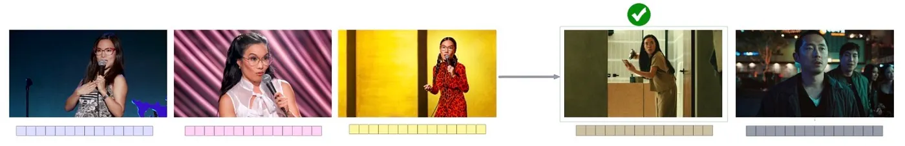
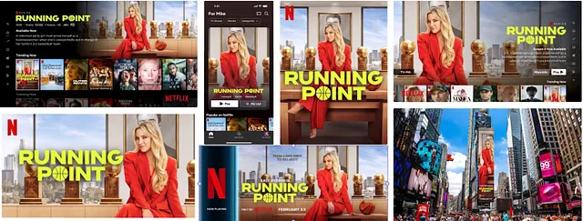
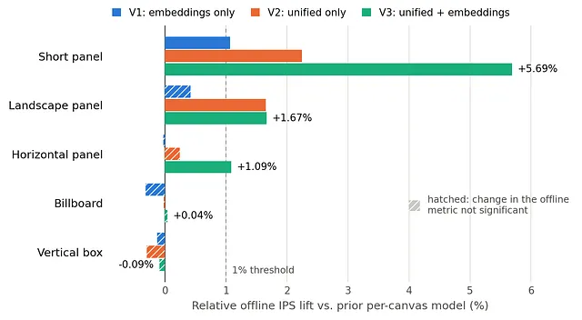
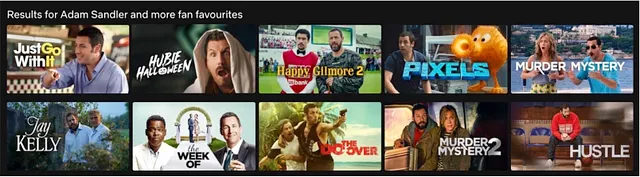
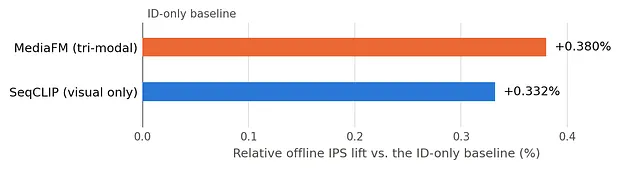
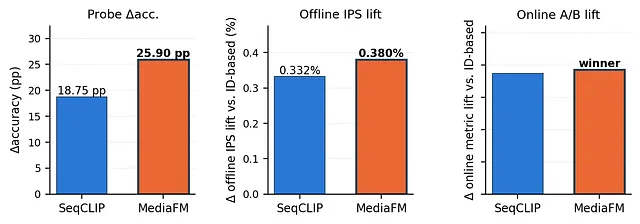
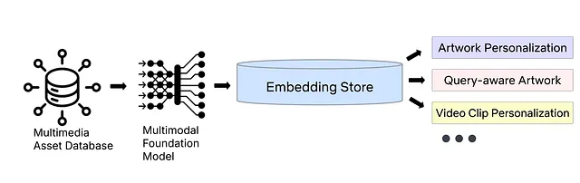

[원문 링크](https://netflixtechblog.com/maps-netflixs-multimodal-asset-personalization-at-scale-32f96320785e)

## Introduction

Netflix의 경험은 발견의 여정입니다. 작품의 아트워크부터 둘러보는 동안 자동 재생되는 영상 미리보기(video preview)까지, 모든 시각적 단서는 여러분이 사랑하게 될 이야기와 여러분을 연결해 주기 위해 존재합니다. 
저희는 이러한 시각적 단서를 **에셋(asset)** 이라고 부르며, 각 회원에게 어떤 에셋을 보여줄지 고르는 것은 그 자체로 하나의 개인화(personalization) 문제입니다. 

그런데 「오징어 게임」의 여러 이미지와 영상 미리보기 중 어떤 것을 여러분에게 보여줘야 할까요? 
그리고 작품이 막 공개된 직후, 각 회원에게 어떤 에셋을 추천해야 할지 판단하기엔 상호작용 데이터가 턱없이 부족할 때는 어떻게 해야 할까요?
오랫동안 저희 모델은 첫 번째 질문에는 잘 답했지만 두 번째 질문에는 제대로 답하지 못했습니다. 
모델은 회원들이 어떤 에셋과 상호작용했는지는 학습했지만, 모든 에셋을 불투명한 ID(Opaque ID)로만 취급했기 때문에 아트워크나 영상 미리보기 안에 실제로 무엇이 담겨 있는지는 전혀 알지 못했습니다. 
작품이 공개된 직후에는 그 에셋들에 아무런 이력이 없었으므로, 상호작용 데이터를 모으기 위해 해당 에셋에 대한 탐색(exploration)을 늘리고, 그 외에는 여러분의 취향을 전혀 반영하지 않는 인기도 기반 휴리스틱으로 후퇴할 수밖에 없었습니다. 
충분한 상호작용이 쌓이고 나서야 비로소 개인화가 작동할 수 있었죠. 이것이 바로 고전적인 **콜드 스타트(cold-start) 문제**입니다.

이 글에서는 **멀티모달 임베딩(multimodal embedding)** 을 통해 모델이 자신이 추천하는 에셋을 "보고 들을 수" 있게 함으로써, 작품 공개 시점에 훨씬 가깝게, 훨씬 더 일찍 개인화가 작동하도록 만든 방법을 공유합니다. 
새 에셋은 모델이 이미 이해하고 있는 임베딩과 함께 도착하기 때문에, 그 임베딩은 관련된 다른 에셋들로부터 얻은 회원 취향 신호를 즉시 담고 있습니다. 
결과적으로 모델은 개인화를 시작하기까지 훨씬 적은 상호작용 이력만 있으면 됩니다. 
이 글에서는 세 가지 프로덕션 시스템인 **아트워크 개인화**, **쿼리 인식(query-aware) 아트워크 랭킹**, **영상 미리보기 개인화** 을 다루고, 더불어 본격적인 엔드투엔드 통합과 A/B 테스트에 착수하기 전에 새로운 임베딩을 저비용으로 선별하는 간단한 요령도 소개합니다.

## Artwork Personalization

이미지 한 장이 회원과 작품의 첫 접점이 되는 경우가 많기 때문에, 저희는 서로 다른 회원 취향에 호소할 수 있도록 작품마다 다양한 아트워크 세트를 제작합니다. 
이미 회원의 상호작용 이력을 바탕으로 한 [개인화 아트워크](https://netflixtechblog.com/artwork-personalization-c589f074ad76)를 사용하고 있지만, 이 접근법은 학습할 행동 데이터가 거의 또는 전혀 없는 신작과 그 에셋들에서는 무너집니다.

### 모델이 아트워크를 "보게" 만들기

저희의 해법은 모델이 그림을 직접 "들여다보게" 하는 것입니다. 각 아트워크를 사전 학습된 이미지-텍스트 임베딩 모델인 [CLIP](https://arxiv.org/abs/2103.00020)으로 인코딩하고, 그 결과를 모델이 해당 에셋을 표현하는 방식에 녹여 넣습니다. 
구체적으로는 에셋별 CLIP 이미지 임베딩(768차원 벡터)을 에셋의 학습된 ID 임베딩과 이어 붙여(concatenate) 에셋 표현을 만듭니다.

$$ {\mathbf h}_{a} = \operatorname{MLP}([\mathbf {e}_{\rm {id}}(a);\mathbf{e}_{a}])$$
- $e_id(a)$는 에셋의 학습된 ID 임베딩이고, $e_a$는 그 에셋의 CLIP 이미지 임베딩입니다. 이 둘을 이어 붙인 뒤 MLP 레이어를 통과시켜 $h_a$를 얻는데, 이것이 모델이 회원과 대조하여 점수를 매기는 표현입니다.

> **왜 MLP를 한 번 더 거치나?**  
> 이어 붙인 벡터를 그대로 쓸 수도 있지만, 그러면 ID 부분과 CLIP 부분이 점수 계산에 _독립적으로_ 기여한다. 
> MLP를 거치면 "이 ID 임베딩이 아직 학습이 덜 됐을 땐 CLIP 쪽을 더 믿자"처럼 두 정보 간의 상호작용을 모델이 스스로 배울 여지가 생긴다. 
> 차원을 회원 표현과 맞추는 투영(projection) 역할도 한다.

이 단 하나의 변경이 모델이 완전히 새로운 아트워크를 다루는 방식을 바꿔 놓습니다. 
처음 보는 ID로 취급하는 대신, **모델은 이제 에셋이 생성되는 순간부터 CLIP 임베딩을 받습니다.** 
덕분에 시각적 테마, 출연진, 색상 팔레트에 대한 회원의 선호가 즉시 적용될 수 있습니다. 그 에셋이 자체적인 상호작용을 쌓기 훨씬 전부터요. 
이러한 선호는 특정 에셋 ID에 묶여 있는 것이 아니라 이미지 임베딩 공간에서 표현되기 때문에, **작품을 넘나들며 매끄럽게 전이됩니다(transfer seamlessly across titles).** 
만약 여러분이 특정 코미디언이 등장하는 아트워크에 꾸준히 반응해 왔다면, 모델은 그 신호를 해당 코미디언의 신작으로 가져가서, 아래 그림처럼 그 사람을 전면에 내세운 에셋을 우선시할 수 있습니다. 그 정확한 이미지를 여러분에게 한 번도 보여준 적이 없더라도 말이죠. 
이렇게 콜드 스타트는 사각지대에서, 임베딩 공간이 이미 근거 있는 의견을 갖고 있는 영역으로 바뀝니다.

> **콜드 스타트 상황에서의 동작**  
> 신작 에셋이라면 $e_id(a)$는 초기값(사실상 무의미)이고 $e_a$만 유효하다. 
> MLP가 학습 과정에서 “$e_a$만으로도 쓸 만한 $h_a$를 만드는 법”을 배워 두었기 때문에, ID 쪽이 비어 있어도 $h_a$가 의미 있는 값이 된다. 
> '임베딩 공간이 이미 근거 있는 의견을 갖고 있다'는 것이 이런 의미다.

- **CLIP 임베딩을 통한 지식 전이.** 어떤 코미디언의 과거 스탠드업 아트워크(왼쪽)와 상호작용한 적이 있는 회원의 경우, 모델은 그 특정 이미지를 한 번도 본 적이 없더라도, 신작 에셋 중 해당 코미디언이 두드러지게 등장하는 쪽(초록 체크)을 그렇지 않은 쪽보다 선호하게 됩니다.

### 다섯 개의 모델에서 하나로

에셋을 그것이 우연히 달고 있는 ID로 점수 매기던 방식에서, 이미지에 실제로 담긴 내용으로 점수 매기는 방식으로의 이 전환은 두 번째 큰 성과인 **모델 통합(model consolidation)** 으로 이어집니다. 
각 작품의 아트워크는 서로 다른 크롭 방식을 가진 여러 캔버스(빌보드, 세로형 박스, 가로형 패널, 짧은 패널, 가로형 넓은 패널)에 걸쳐 있는데, 과거에는 캔버스별로 별도의 모델을 학습시켰습니다. 
ID 기반 모델은 한 장면을 잘라내고 크기를 조정한 여러 렌더링이 서로 관련되어 있다는 사실을 알 길이 없었기 때문에, 캔버스 간에 신호가 흐를 수 없었고 각 캔버스가 저마다의 콜드 스타트를 겪어야 했습니다.

CLIP 임베딩은 이 장벽을 허뭅니다. CLIP 임베딩은 크롭, 리사이즈, 종횡비에 대해 대체로 불변(invariant)이기 때문에, 거의 동일한 이 렌더링들은 아래쪽 그림이 보여주듯 거의 같은 벡터로 매핑됩니다. 
따라서 하나의 통합 모델이 모든 캔버스에 걸친 상호작용 신호를 한데 모을 수 있고(pool), 트래픽이 많은 캔버스에서 학습된 회원의 선호가 데이터가 희소한 캔버스에서 고르는 아트워크에 즉시 반영됩니다. 
그 결과 다섯 개였던 모델이 하나가 되었으며, 상호작용 데이터가 가장 적은 캔버스에서 가장 큰 개선 효과가 났습니다.

- **하나의 원본 이미지, 여러 캔버스.** 같은 「Running Point」 아트워크가 빌보드, TV, 모바일, 옥외(out-of-home) 광고 자리에 맞게 잘리고 크기가 조정되며, 각각 서로 다른 에셋 ID를 갖습니다. CLIP 임베딩은 크롭과 리사이즈에도 거의 변하지 않기 때문에, 하나의 통합 모델이 이 모든 것을 개인화할 수 있습니다.

### 다섯 캔버스의 학습 데이터 섞기

통합은 캔버스별 모델에서는 겪어 본 적 없는 과제를 하나 가져왔습니다. *서로 다른 캔버스의 데이터를 어떻게 효과적으로 섞을 것인가?*
캔버스들은 노출량에서 큰 차이가 나고, 각 캔버스에 기록되는 상호작용이 회원의 장기적인 경험에 갖는 가치도 모두 같지 않습니다. 
원시 카운트를 그대로 합쳐서 학습하면 노출량이 가장 많은 캔버스와 가장 빈번한 상호작용 유형이 지배하게 되어, 정작 도우려 했던 데이터가 적은 캔버스가 가장 적은 혜택을 받게 됩니다. 
캔버스별 가중치를 손으로 조정하는 것은, 문제를 근거 없는 하이퍼파라미터 한 묶음과 그것들을 맞추기 위한 끝없는 온라인 실험으로 바꿔치기하는 것에 불과합니다.

대신 저희는 Netflix의 [장기 보상 모델링](https://netflixtechblog.com/recommending-for-long-term-member-satisfaction-at-netflix-ac15cada49ef)을 기반으로 한 보상 기반 가중치(reward-based weighting)를 사용합니다. 
각 학습 예제는 해당 상호작용 유형에 부여된 장기 보상 점수로 가중됩니다:

$$ w(a_{ti}) = \rho(e(a_{ti})) $$

- $a_{ti}$ 는 학습 예제로, 작품 $t$의 에셋 $i$에 대한 긍정적 상호작용 하나입니다. 그 가중치는 해당 예제에서 관찰된 상호작용 유형 $e$에 의해 정해지며, 그 유형의 장기 보상인 $\rho$로 점수화됩니다.

여기서 $e(·)$는 관찰된 긍정적 상호작용의 유형이고, $\rho$는 그 유형의 장기 보상 점수입니다. 
상호작용 유형이 캔버스마다 고르게 분포하지 않기 때문에, 장기적인 가치로 가중하는 것만으로 캔버스 혼합 비율이 저절로 재조정되며, 손으로 정한 가중치는 하나도 없습니다. 
각 캔버스는 우연히 얻게 된 노출 수가 아니라, 그 캔버스가 유발하는 상호작용의 장기 가치에 비례하여 기여합니다.
이로써 통합이 실현 가능해지고, 통합 모델은 가장 빈번한 단기 행동이 아니라 장기적인 회원 만족을 최적화하게 됩니다.

### 오프라인 평가에 관한 노트

여기 제시된 모든 결과는 두 가지 관문을 통과해야 합니다. 먼저 오프라인 지표 평가, 그다음 대규모 온라인 A/B 테스트입니다. 까다로운 쪽은 오프라인 지표입니다. 
현재 프로덕션 정책의 로그로 새 모델을 판단하는 것은 편향되어 있는데, 그 정책이 어떤 에셋은 다른 에셋보다 훨씬 자주 보여주기 때문입니다. 로그에 기록된 보상은 그 정책이 무엇을 선호했는지를 말해 줄 뿐, 전체 후보 집합에서 회원이 무엇을 골랐을지를 말해 주지는 않습니다. 
그래서 로깅 정책과 의견이 다른 새 모델은 실제보다 나빠 보이게 되는데, 새 모델이 골랐을 노출들이 데이터에 거의 들어 있지 않기 때문입니다.

> Q) 데이터에 없을 때 새 모델이 왜 나빠보이게 되는 걸까?
> 오프라인 평가 방식인 replay 방식의 허점을 보자.
> 
> 작품에 에셋 A, B, C가 있다. 회원 100명이 있고, 기존 모델이 각 회원에게 에셋 하나를 보여줬다.
> 기존 모델이 90명에게 A, 9명에게 B, 1명에게 C를 보여줬다고 가정하자.
> 
> 이제 새 모델을 평가한다. 새 모델은 100명 각각의 로그를 보고 '나라면 이걸 보여주겠다'고 답한다.
> 실제로 100명 중 50명은 C를 보여줬으면 클릭했을 사람들이고, 모델이 그걸 정확히 알아서 50명에게 C를 준다고 가정해보자. 나머지는 A를 고른다고 가정하자.
> 
> 1. 새 모델의 답이 로그와 **같으면**, 그 줄의 결과(클릭 여부)를 새 모델의 점수에 반영한다.
> 2. 새 모델의 답이 로그와 **다르면**, 그 줄은 **버린다**. 그 때의 결과는 로그에 없기 때문이다.
> 3. 반영된 줄들의 클릭률이 새 모델의 점수가 된다.
> 
> 숫자로 보면 새 모델의 점수는 A를 고른 경우의 클릭률 만으로 계산되고, 이건 기존 모델과 비슷하거나 낮게 나온다. C로 끌어올렸을 50명의 클릭이 점수에 거의 기여하지 못하기 때문이다.

저희는 이를 **탐색 트래픽**의 전용 슬라이스에서 계산한 **[역성향 점수(inverse propensity scoring, IPS)](https://arxiv.org/abs/1602.05352)** 로 처리합니다. 
전체 트래픽의 작은 일부를 무작위 정책이 담당하는데, 이 정책은 작품의 후보 에셋들 중에서 알려진 분포에 따라 샘플링합니다. 
따라서 주어진 맥락에서 특정 에셋을 보여줄 성향(propensity)이 나중에 추정되는 것이 아니라 서빙 시점에 정확히 기록됩니다. 모든 관측치를 기록된 성향의 역수로 재가중하면 다음을 얻습니다:

$$ \hat{R}_{\rm{IPS}} = \frac {1} {|D|} \sum _{(x,a) \in D}{\frac {r(x,a)}{p(a | x)}} $$

여기서 $D$는 탐색 슬라이스이고, $r(x, a)$는 '재생'같은 관측된 보상입니다. 
탐색 과정에서 드물게 노출된 것들은 그에 맞춰 상향 가중되며, 이 추정량은 후보 정책을 실제로 배포했더라면 얻었을 보상의 편향 없는 추정치가 됩니다.
성향(propensity)을 사후에 모델링하는 것이 아니라 설계상 알고 있다는 점이, 저희 경험상 오프라인 수치가 온라인 결과를 잘 따라가는 가장 큰 단일 요인입니다.
저희는 IPS를 프로덕션 베이스라인 대비 비율로 보고하며, 후보 모델은 여기서 이겨야만 A/B 트래픽을 받을 수 있습니다.

### 두 아이디어를 합치면 더 잘 작동한다

여기에는 두 가지 아이디어가 함께 묶여 있으므로, 기존의 다섯 모델 프로덕션 시스템을 기준으로 각각을 따로 떼어 내어 절제 실험(ablation)을 했습니다.

- **V1, 이미지 임베딩만.** 캔버스별 다섯 모델은 그대로 두고, 각 모델에 이미지 임베딩만 추가.
- **V2, 통합 모델만.** 다섯 캔버스 전체를 하나의 모델로 학습하되, 학습된 ID 임베딩만 쓰고 이미지 내용은 사용하지 않음.
- **V3, 둘 다.** 다섯 캔버스 전체를 아우르는 통합 모델에, 에셋 표현 안에 이미지 임베딩까지 포함.

아래 차트가 보여주듯, 각 아이디어는 정확히 예상했던 곳에서 도움이 되었습니다. 데이터가 부족한 짧은 패널 캔버스와 가로형 넓은 패널 캔버스입니다. 
V3가 분명한 승자였습니다. 이 오프라인 지표에서 ±1% 이내의 변화는 유의하지 않으며, 차트에서 그런 막대는 빗금으로 표시했습니다. V1과 V2가 단독으로 내는 효과의 대부분은 그 범위 안에 들어갑니다.

- 세 가지 변형 각각에 대한 캔버스별 상대적 오프라인 IPS 상승률. 각 값은 같은 캔버스의 기존 캔버스별 모델을 기준으로 측정한 것입니다. 두 아이디어 모두 상호작용 데이터가 가장 희소한 곳에서 도움이 되며, V3가 가장 강합니다. 빗금 막대는 ±1% 범위 안에 있어 오프라인 지표의 변화가 유의하지 않은 경우이고, V3 값은 차트에 숫자로 표시되어 있습니다.

모든 기기 플랫폼에 걸쳐 최소 4주간 진행한 온라인 A/B 테스트에서는 결과가 훨씬 더 선명하게 갈렸습니다. 
*두 아이디어 중 어느 것도 단독으로는 온라인 핵심 회원 지표를 움직이지 못했습니다.*
V1과 V2는 둘 다 지표에 변화가 없었고 그 차이도 통계적으로 유의하지 않았으며, V3만이 통계적으로 유의한 상승을 거두었습니다. 지금 프로덕션에서 운영 중인 것이 바로 이 V3입니다.

두 재료는 서로를 필요로 합니다. V1은 캔버스별 모델에게 에셋이 어떻게 생겼는지 알려주지만, 희소한 캔버스 하나에는 그 정보를 어떻게 *활용할지* 가르칠 예제가 너무 적습니다. 
V2는 데이터를 풍부하게 공급하지만 ID 기반 데이터뿐이고, 새 에셋에는 그것이 없습니다. 
V3는 둘 다 갖추고 있어서, 성숙한 캔버스들이 공유 모델에게 CLIP 임베딩이 회원 선호에 어떻게 대응되는지를 가르치고, 그 대응 관계가 희소한 캔버스로 곧바로 전이됩니다. 
**효과는 더해지는 것이 아니라 증폭**됩니다. V3의 짧은 패널 상승률(5.691%)이 V1과 V2를 합친 것보다 크기 때문입니다. 
여기서 얻은 교훈은, **콘텐츠 피처가 도움이 안 된다고 결론 내리기 전에 두 번째 걸림돌이 있는지 먼저 찾아보라는 것입니다.** 

### 새 UI 출시가 가져온 콜드 스타트 과제(Cold-Start Challenge from a New UI Launch)

진짜 시험대는 이 작업을 시작하게 만든 제품 변경이었습니다. Netflix는 [10년 만의 최대 규모 TV 홈 화면 개편](https://www.nytimes.com/2025/05/07/business/media/netflix-new-home-screen.html)을 준비하고 있었는데, 이 개편이 적용되면 짧은 패널이 사실상 하룻밤 사이에 가장 많이 노출되는 아트워크 캔버스가 될 예정이었습니다.
콜드 스타트 문제가 가장 극단적인 형태로 나타난 셈입니다. 곧 가장 많은 노출을 받게 될 캔버스에 과거 데이터가 가장 적었고, 그렇다고 짧은 패널의 상호작용이 쌓일 때까지 기다리면 그동안 사용자 경험이 나빠질 수밖에 없었습니다.
모델 통합 덕분에 짧은 패널의 에셋 선택에 모든 캔버스에서 모은 신호를 끌어다 쓸 수 있었고, CLIP 임베딩 덕분에 자체 상호작용이 거의 없는 짧은 패널 에셋도 통합 모델이 개인화할 수 있었습니다.

저희는 출시 전에 V3를 배포하고, 소수의 대조군만 기존 캔버스별 모델에 남겨 둔 채 한 달간의 홀드백(holdback) A/B 테스트로 효과를 측정했습니다. 
V3는 이 급격한 변화에도 흔들림 없이 처음부터 제 역할을 했습니다. 핵심 발견 지표와 스트리밍 시간 모두에서 통계적으로 유의한 개선이 나타났고, 그 폭은 평상시 조건에서 진행한 절제 실험보다 컸습니다. 
이는 예상했던 결과입니다. 어떤 캔버스가 중심이 되는지가 갑자기 바뀌는 상황이야말로 V3가 가장 큰 힘을 발휘해야 할 지점이기 때문입니다.

## 검색어 반영 아트워크 개인화(Query-Aware Artwork Personalization)

홈 화면을 훑어볼 때는 평소 취향이 좋은 단서가 되지만, 검색할 때는 그렇지 않습니다.
예를 들어 특정 배우를 검색했다면, 평소 취향과 맞지 않더라도 그 배우가 나오는 아트워크를 보고 싶을 것입니다.
Netflix 검색 페이지에서는 회원이 무엇을 원하는지가 검색어에 그대로 드러나 있으니, 화면에 보여주는 아트워크도 그에 맞아야 합니다.

콜드 스타트 문제를 풀려고 도입한 CLIP 임베딩이 이 기능을 거의 덤으로 가능하게 해 줍니다. 
CLIP은 텍스트와 이미지를 같은 임베딩 공간에 놓기 때문에, 검색어의 텍스트 임베딩과 에셋의 이미지 임베딩 사이의 코사인 유사도만 구하면 검색어와 후보 아트워크가 얼마나 잘 맞는지를 바로 잴 수 있습니다. 
이렇게 구한 정합 점수를 **기존 개인화 점수와 섞어서** 씁니다:

$$ s(x,a,q) = \alpha \cdot s_{\rm{pers}}(x,a) +(1-\alpha)\cdot \cos(\mathbf{e}_{q}^{\rm{txt}}, \mathbf{e}_{a}^{\rm{img}})$$

여기서 **개인화 항**은 앞서 설명한 **아트워크 모델이 회원과 에셋에 대해 이미 내놓는 점수**이고, **두 번째 항** 은 **검색어의 텍스트 임베딩과 에셋의 이미지 임베딩을 비교한 값**이며, 0과 1 사이의 혼합 가중치 $\alpha$는 온라인 A/B 테스트로 조정합니다.
첫 번째 항은 "우리가 생각하기에 당신이 좋아할 것"이고, 두 번째 항은 "당신이 방금 요청한 것"이며, $\alpha$는 둘 중 어느 쪽을 얼마나 중요하게 볼지를 정합니다.

> 예를 들어보자.
> 회원 한 명이 검색창에 "박은빈"을 입력했다. 검색 결과에 「이상한 변호사 우영우」가 나온다. 
> 이 작품에는 후보 아트워크가 세 장 있다고 해보자.
>
> - 에셋 A: 박은빈 얼굴이 크게 나온 이미지
> - 에셋 B: 법정 전체가 나온 이미지, 인물은 작게
> - 에셋 C: 고래와 바다가 나온 몽환적 이미지
>  
> 1. 첫 번째 항: $s_{\rm{pers}}(x, a)$
> 검색과 무관하게, 아트워크 모델이 내놓는 점수.
> 이 회원이 평소 자연 다큐를 즐겨 본다면, 모델은 C에 높은 점수를 줄 것이다. 
> 예를 들어 A는 0.3, B는 0.4, C는 0.8과 같이 줄 수 있는 것이다.
> 2. 두 번째 항: $\cos(e_q^{\rm{txt}}, e_a^{\rm{img}})$
> 검색어와 에셋의 유사도. "박은빈"이라는 글자를 CLIP에 넣어 벡터로 만들고, 세 이미지의 벡터와 각각 비교한다.
> 3. $\alpha$
> 두 점수를 어떤 비율로 합칠지 결정한다. 앞서 두 항의 답이 취향은 C, 검색어는 A로 다르다. 
> 어느 쪽을 얼마나 믿을지 비율이 $\alpha$ 로 정해진다.

중요한 점은, 여기에 추가적인 모델링 작업이 전혀 들지 않았다는 것입니다. 
앞선 아트워크 작업 덕분에 CLIP 임베딩이 이미 에셋 표현 안에 들어 있고, 그 임베딩은 텍스트-이미지 정합 정보를 그대로 품고 있으므로, 점수 계산 시점에 유사도 항 하나만 더하면 검색어를 반영하는 랭커가 됩니다. 
그 효과는 검색 결과 화면에서 바로 확인할 수 있습니다.

- 특정 배우를 검색했을 때의 검색어 반영 아트워크(query-aware artwork). 각 검색 결과마다 검색한 배우가 실제로 등장하는 에셋이 선택되어, 아트워크가 회원이 명시한 의도와 일치합니다.

## MediaFM을 활용한 영상 미리보기 개인화

영상 미리보기는 정지 이미지보다 다루기가 한층 까다롭습니다. 
시간에 따라 흘러가는 데다, 매력의 상당 부분이 어느 단일 프레임이 아니라 움직임과 편집 호흡, 대사, 배경음악에서 나오기 때문입니다. 
예전의 영상 미리보기 개인화 모델은 이 가운데 어느 것도 보지 못했습니다. 초기 아트워크 모델과 마찬가지로 미리보기 하나하나를 그저 ID로만 취급했습니다. 
내용을 반영하려는 첫 시도였던 SeqCLIP은 영상을 프레임 단위로 쪼개 각 프레임을 CLIP으로 인코딩한 뒤 평균을 내서 벡터 하나로 만드는 방식이었습니다. 
이렇게 하면 미리보기가 어떻게 보이는지는 담을 수 있습니다. 하지만 정지 프레임의 평균으로는 어떻게 들리는지는 여전히 알 수 없습니다. 
미리보기의 분위기를 크게 좌우하는 대사와 음악이 빠지는 것입니다.

이 빠진 부분을 채우기 위해 Netflix 최초의 자체 멀티모달 파운데이션 모델인 [MediaFM](https://netflixtechblog.com/mediafm-the-multimodal-ai-foundation-for-media-understanding-at-netflix-e8c28df82e2d)을 도입했습니다. 
MediaFM은 8천만 개의 샷들로 학습되었으며, 샷마다 아래 세 가지 신호를 하나의 임베딩으로 합칩니다.

- 시각: SeqCLIP
- 오디오: 사전 학습된 음성 및 오디오 임베딩 모델
- 텍스트: 대규모 텍스트 모델로 인코딩한 자막

MediaFM을 도입하는 데 새 인프라는 필요 없었습니다. 
아트워크에 CLIP 임베딩을 넣었을 때와 똑같이, MediaFM의 샷 임베딩을 에셋 표현에 끼워 넣기만 하면 되었기 때문입니다.

모달리티를 추가한 보람은 있었습니다(paid off). 두 임베딩을 ID만 쓰는 베이스라인과 비교해 먼저 오프라인 IPS로 평가하고, 이어서 모든 기기 플랫폼에서 5주간 온라인 A/B 테스트를 진행했습니다. 
두 평가 모두 `MediaFM > SeqCLIP > ID만 사용` 순서를 보였고, 내용 반영 수준을 한 단계 높일 때마다 성능이 좋아졌으며, 개선 폭은 TV에서 가장 컸습니다. 
아래 차트에서 보듯 오프라인에서는 내용을 반영한 두 임베딩 모두 IPS에서 베이스라인을 앞섰고, 그중에서도 MediaFM이 SeqCLIP보다 높았습니다. 
온라인에서도 MediaFM이 가장 좋았습니다. 핵심 스트리밍 지표에서 베이스라인 대비 통계적으로 유의한 개선을 보였고 SeqCLIP도 앞질렀습니다. 
이는 SeqCLIP처럼 영상만 보는 인코더가 잡아낼 수 없는 **오디오와 자막 신호가 실제로 가치를 더한다**는 뜻입니다. 
이후 MediaFM을 모든 플랫폼의 기본 영상 미리보기 임베딩으로 배포했습니다.

- 두 가지 content-aware video preview 임베딩의 상대적 오프라인 IPS 상승률. 각각 ID-only 베이스라인을 기준선(0)으로 두고 측정한 값입니다. 시각 정보를 더하면 성능이 좋아지고, 그 위에 오디오와 자막을 더하면 더 좋아집니다.

### 프록시 과제로 임베딩을 저렴하게 고르기(Choosing Embeddings Cheaply with a Proxy Task)

새 임베딩은 끊임없이 나오지만, 엔드투엔드로 시험해 보는 데는 비용이 많이 듭니다. 
데이터 엔지니어링, 모델 재학습, 그리고 몇 주치 A/B 테스트 트래픽이 들어가기 때문입니다.
후보가 나올 때마다 전체 파이프라인을 돌릴 수는 없었으므로, 저희는 검증의 첫 관문으로 비용이 거의 들지 않는 질문 하나를 두었습니다.

**콘텐츠 임베딩만 보고, 개인화 없는 단순 정책에서 어떤 에셋이 이길지 맞힐 수 있는가?**

먼저 작품을 고정된 집합으로 골라 둡니다. 그 다음 각 작품에 대해 탐색 데이터를 이용해 편향을 제거한 인기 1위 에셋을 찾습니다. 이는 **노출 빈도를 성향 점수로 보정하고 나서 상호작용률이 가장 높은 에셋**입니다.
이 승자에게는 1, 나머지에는 0이라는 이진 레이블을 붙입니다. 그런 다음 작품, 출연진, 메타데이터 없이 에셋 임베딩만으로 이 레이블을 맞히는 선형 프로브(linear probe)를 학습시키는데, 표준적인(standard) 이진 교차 엔트로피 손실을 최소화하는 방식입니다:

$$ \mathcal{L}(\theta) = -\sum_{t,i} \left[ y_{ti} \log f_\theta(\mathbf{x}_{ti}) + (1-y_{ti}) \log \left(1 - f_\theta(\mathbf{x}_{ti})\right) \right] $$

프로브를 선형으로, 그리고 임베딩만 입력으로 제한한 것은 의도적인 선택입니다. 그래야 에셋의 인기 중 얼마만큼이 실제로 임베딩 안에 담겨 있는지를 따로 떼어 잴 수 있기 때문입니다. 
임베딩이 인기를 만들어 내는 의미적 요인을 담고 있다면, 단순한 선형 분류기로도 1위가 될 만한 에셋을 가려낼 수 있어야 합니다. 
그렇지 않다면 프로브는 무작위 추측보다 나을 게 없을 텐데, 바로 그 무작위 추측이 프로브의 성능을 비교하는 기준선입니다.

저희는 프로덕션 파이프라인을 손대기 전에 이 선형 프로브로 폭넓은 후보 임베딩들을 먼저 걸러 내어, SeqCLIP과 가장 유망한 MediaFM 변형이라는 두 최종 후보로 좁혔습니다. 
그런 다음 이 둘만 전체 오프라인 평가와 온라인 A/B 테스트에 올렸습니다. 
아래 차트가 보여주듯 선형 프로브 정확도, 오프라인 IPS 상승률, 온라인 A/B 결과라는 세 신호 모두 MediaFM을 SeqCLIP보다 앞에 두었습니다. 
이렇게 세 신호가 일치했기 때문에, 지금은 새 MediaFM 버전이 나올 때마다 선형 프로브가 출시 전 관문 역할을 하고 있습니다.

- 두 최종 후보에 대한 선형 프로브 정확도 변화량(Δaccuracy), 오프라인 IPS 상승률, 온라인 A/B 지표 상승률. 세 지표 모두 MediaFM이 SeqCLIP보다 낫다는 데 일치합니다. 온라인 패널은 ID 기반 베이스라인 대비로 측정했으며, 구체적인 수치는 공개하지 않았습니다.

## Netflix 임베딩 스토어(The Netflix Embedding Store)

공유 인프라가 없었다면 이 모든 것은 현실적으로 불가능했을 것입니다. 이 글에 등장하는 모든 임베딩, 즉 아트워크용 CLIP과 영상 미리보기용 SeqCLIP·MediaFM은 전부 **Netflix 임베딩 스토어**에 저장되어 있습니다. 
임베딩 스토어는 Netflix AI 플랫폼의 한 구성 요소로, 작품, 게임, 회원 프로필, 멀티미디어 에셋의 밀집(dense) 임베딩을 보관하고 제공합니다. 
파운데이션 모델이 에셋의 원본 콘텐츠를 밀집 벡터로 한 번 인코딩하면, 임베딩 스토어가 그 벡터를 아트워크 모델, 검색어 반영 랭커, 영상 미리보기 모델 등 모든 하위 시스템(downstream)에 동일한 인터페이스로 제공합니다. 
특히 중요한 점은 학습 시점과 온라인 추론 시점에 정확히 같은 임베딩을 제공한다는 것으로, 모델이 학습한 것과 프로덕션에서 보는 것 사이에 어긋남(skew)이 생기지 않습니다.

임베딩 스토어의 핵심 성질은 **파운데이션 모델의 업데이트와 개인화 모델의 배포를 서로 분리한다**는 것입니다. 
새 임베딩이든 기존 임베딩의 새 버전이든, 그것을 사용하는 어떤 모델의 학습 코드나 서빙 코드도 건드리지 않고 등록하고, 카탈로그 전체에 대해 백필(backfill)하고, 독립적으로 검증할 수 있습니다. 
일단 임베딩 스토어에 들어가면 모든 랭킹·개인화 모델이 설정 변경만으로 그 임베딩을 쓸 수 있습니다.
임베딩을 사용하는 쪽(downstream) 코드 변경도, 팀 간 조율된 릴리스도 필요 없습니다.
덕분에 아트워크 모델에 CLIP을 끼워 넣고, 같은 벡터 위에 검색어 반영 랭커를 세우고, 영상 미리보기 모델에 MediaFM을 적용하는 일을 각각 독립된 변경으로 처리할 수 있었습니다. 
여러 팀이 함께 움직여야 하는 마이그레이션이 아니었던 것입니다.

파운데이션 모델 임베딩(CLIP, SeqCLIP, MediaFM)은 한 번만 저장되고, 아트워크, 검색어 반영 아트워크, 영상 미리보기, 그 밖의 랭커 등 이를 사용하는 모든 시스템이 가져다 씁니다.

## What We Learned, and What’s Next

세 가지 교훈이 두드러졌습니다.

1. 사전 학습된 CLIP 임베딩 덕분에 다섯 개의 아트워크 모델을 하나로 합치면서도 데이터가 부족한 캔버스에서 성능을 끌어올릴 수 있었습니다. 이 이점은 TV 홈 화면 개편이 적용되었을 때 특히 분명하게 드러났습니다.
2. 영상에서는 멀티모달이 확실하게 이깁니다. 시각 정보만 다루는 인코더로는 접근할 수 없는 오디오와 텍스트 신호가 MediaFM을 SeqCLIP보다 앞서게 했습니다.
3. 저렴한 프록시 과제는 큰 비용 절감으로 이어집니다. 엔드투엔드 실험과 온라인 A/B 테스트에 들어가기 전에 후보 집합을 효율적으로 추려 줍니다.

다음으로는 임베딩 스토어를 **이미지, 텍스트, 영상이 하나의 의미 공간을 공유**하는 방향으로 확장하고자 합니다. 
이렇게 통합된 표현이 있으면 영상 미리보기를 검색어에 매칭하거나, 정지 아트워크를 그것이 유래한 영상 미리보기에 매칭하는 것 같은 교차 모달 검색이 가능해집니다. 
또 화면 종류를 가리지 않는 통합 에셋 랭킹과, 어디서든 회원에게 더 일관되고 직관적인 발견 경험을 제공할 수 있게 됩니다.

## 감사의 말

이 글에서 설명한 내용 반영 모델을 가능하게 한 CLIP 임베딩과 MediaFM 작업을 해 주신 [Aneesh Vartakavi](https://www.linkedin.com/in/aneeshvartakavi/), [Santiago Castro](https://www.linkedin.com/in/santiagocastroserra/), [Avneesh Saluja](https://www.linkedin.com/in/avneesh/)와, 프로덕션에서 멀티미디어 개인화를 서빙하는 백엔드 시스템을 담당해 주신 [Ratna Kavuri](https://www.linkedin.com/in/rkavuri/)에게 감사드립니다.