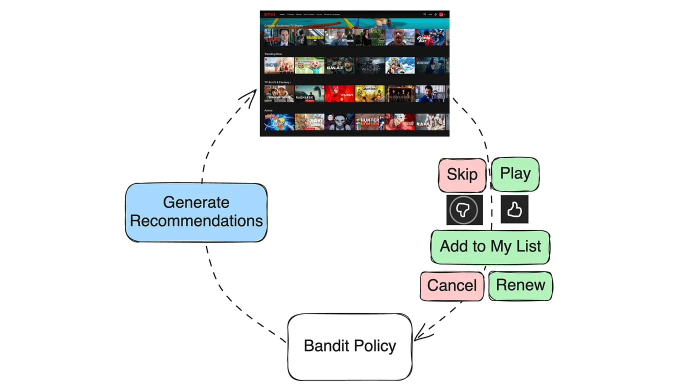
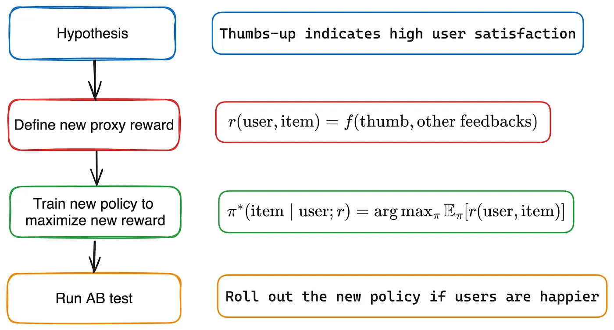
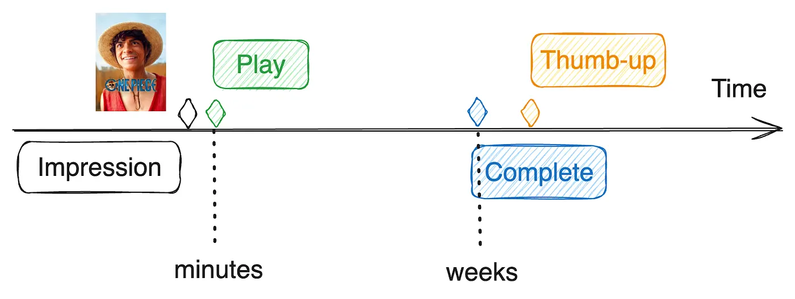
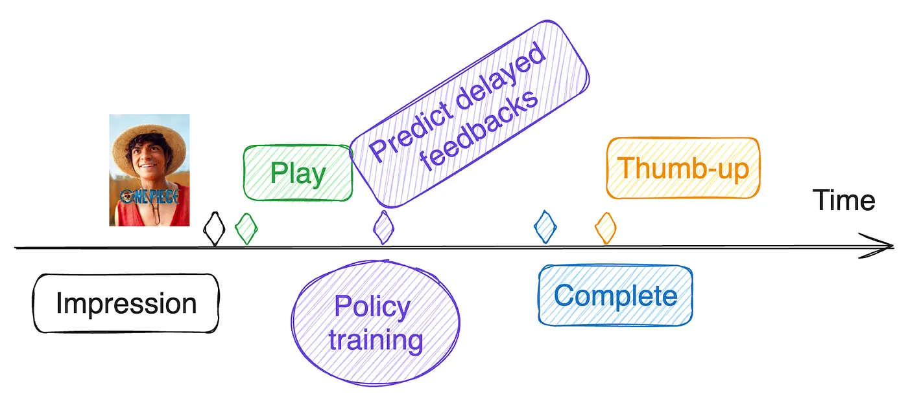

Aug 29, 2024
[원문 링크](https://netflixtechblog.com/recommending-for-long-term-member-satisfaction-at-netflix-ac15cada49ef)

## Introduction

넷플릭스의 사명은 전 세계를 즐겁게 하는 것입니다. 우리의 개인화 알고리즘은 적절한 시점에 알맞은 시리즈, 영화, 게임을 추천함으로써 모든 회원에게 이 사명을 실현하는 데 핵심적인 역할을 합니다. 
이 목표는 당장의 참여(immediate engagement)를 이끌어 내는 데 그치지 않습니다. 우리는 회원들에게 지속적인 즐거움을 주는 경험을 만들고자 합니다. 
기존의 전통적인 추천 시스템은 클릭 수나 참여도 같은 단기 지표를 최적화하는 경우가 많지만, 이런 지표는 장기적인 만족도를 충분히 반영하지 못할 수 있습니다. 
저희는 당장 회원의 관심과 이용을 이끌어 내는 동시에, 장기적인 만족도까지 높여주는 콘텐츠를 추천하고자 노력합니다. 
장기 만족도가 높아지면 회원이 넷플릭스에서 얻는 가치가 커지고, 그만큼 회원 자격을 계속 유지할 가능성도 높아지기 때문입니다.

## 컨텍스추얼 밴딧으로 보는 추천 (Recommendations as Contextual Bandit)

추천을 바라보는 간단한 방법 하나는 추천을 컨텍스추얼 밴딧(contextual bandit) 문제로 보는 것입니다. 
회원이 서비스를 방문하면 그것이 우리 시스템에게는 하나의 컨텍스트(context)가 되고, 시스템은 어떤 추천을 보여줄지 행동(action)을 선택하며, 이어서 회원은 다양한 형태의 피드백을 제공합니다. 
이 피드백 신호는 즉각적일 수도 있고(건너뛰기, 재생, 좋아요/싫어요, 찜한 콘텐츠 목록에 추가), 지연되어 나타날 수도 있습니다(시리즈 정주행 완료, 구독 갱신). 
우리는 이러한 피드백 신호로부터 추천의 품질을 반영하는 보상 함수(reward function)를 정의하고, 과거 데이터를 바탕으로 기대 보상(expected reward)을 최대화하도록 컨텍스추얼 밴딧 정책(policy)을 학습시킬 수 있습니다.

## 추천 개선: 모델과 최적화 목표(Improving Recommendations: Models and Objectives)

추천 모델을 개선하는 방법은 다양합니다. 
더 유용한 정보를 담은 입력 피처(feature), 더 많은 데이터를 활용하거나, 다른 아키텍처로 바꾸거나, 파라미터 수를 늘리는 등의 방법이 있습니다.
이 글에서는 상대적으로 덜 논의되는 측면에 초점을 맞춥니다. 바로 **장기적인 회원 만족도를 더 잘 반영하려는 보상 함수를 정의**해, **추천 시스템의 목적 함수(objective) 자체를 개선하는 문제**입니다.

## 구독 유지를 보상으로 삼을 수 있을까?(Retention as Reward?)

회원 리텐션(retention, 구독 유지)은 장기 만족도를 최적화하기 위한 보상으로 당연해 보일 수 있습니다. 만족한 회원이라면 서비스에 남아 있을 것이기 때문입니다. 
그러나 여기에는 몇 가지 단점이 있습니다.

- **잡음이 많음(Noisy)**: 리텐션은 계절적 추세, 마케팅 캠페인, 서비스와 무관한 개인 사정 등 수많은 외부 요인의 영향을 받을 수 있습니다.
- **민감도가 낮음(Low Sensitivity)**: 리텐션은 구독 해지 직전에 있는 회원에 대해서만 민감하게 반응하며, 회원 만족도의 전체 스펙트럼을 담아내지 못합니다.
- **어떤 추천의 영향인지 가려내기 어려움(Hard to Attribute)**: 회원은 나쁜 추천이 여러 번 쌓인 뒤에야 해지할 수 있습니다.
- **측정이 느림(Slow to Measure)**: 계정당 한 달에 한 번의 신호만 얻을 수 있습니다.

이러한 어려움 때문에 리텐션만을 최적화하는 것은 현실적이지 않습니다.

## 대리 보상(Proxy Reward)

그 대신, 우리는 장기적인 회원 만족도와 높은 일치도(alignment)를 가지면서도 개별 추천에 민감한 **대리 보상 함수(proxy reward function)** 를 최적화하도록 밴딧 정책을 학습시킬 수 있습니다. 
대리 보상 $r(user, item)$은 추천된 아이템에 대한 사용자의 상호작용을 입력으로 하는 함수입니다. 
예를 들어 우리가 "원피스"를 추천했을 때 회원이 그것을 재생하고, 이어서 끝까지 보고, 좋아요까지 눌렀다면, 간단한 대리 보상은 $r(user, item) = f(play, complete, thumb)$과 같이 정의할 수 있습니다.

> Proxy Reward가 갖춰야 할 조건
> 1) 장기 만족도와 같은 방향으로 움직일 것
> 2) 추천 하나하나에 반응할 것
> 즉 $r(user, item) = f(play, complete, thumb)$이라는 수식의 의미는,
> 보상이 회원 전체의 한 달이라는 긴 시간이 아니라 **이 회원에게 이 아이템을 추천한 한 번**으로 정의된다는 것이다.

### Click-through rate (CTR)

클릭률(click-through rate, CTR), 우리의 경우에는 재생률(play-through rate)은 가장 단순한 대리 보상으로 볼 수 있습니다. 
사용자가 추천을 클릭하면 $r(user, item) = 1$, 그렇지 않으면 0인 함수입니다. 
CTR은 일반적으로 사용자의 선호에 대한 기대를 반영하는 흔한 피드백 신호입니다. 단순하지만 많은 추천 응용에서 강력한 베이스라인(baseline)이 됩니다. 
클릭 자체가 목표 행동인 광고 개인화 같은 일부 경우에는 CTR이 프로덕션 모델의 보상으로도 충분히 합리적일 수 있습니다. 
그러나 대부분의 경우 CTR을 과도하게 최적화하면 낚시성(clickbaity) 아이템을 띄우게 되고, 이는 장기 만족도를 해칠 수 있습니다.

### Beyond CTR

대리 보상 함수를 장기 만족도와 더 가깝게 일치시키려면, 단순한 상호작용 너머를 보고, 모든 유형의 사용자 행동을 고려하며, 그 행동들이 사용자 만족도에 대해 실제로 무엇을 의미하는지 이해해야 합니다.

넷플릭스 맥락에서 몇 가지 예를 들어 보겠습니다.

- **빠른 시즌 완주 ✅**: 추천한 TV 시리즈의 한 시즌을 하루 만에 다 보는 것은 즐거움과 장기 만족도의 강한 신호입니다.
- **완주 후 싫어요 ❌**: TV 시리즈를 몇 주에 걸쳐 다 본 뒤에 싫어요를 누르는 것은, 상당한 시간을 들였음에도 만족도가 낮다는 뜻입니다.
- **영화를 10분만 재생 ❓**: 이 경우 사용자의 만족도는 모호합니다. 짧은 시청은 사용자가 그 영화를 포기하기로 했다는 뜻일 수도 있고, 단순히 중간에 방해를 받아 나중에, 이를테면 다음 날 마저 볼 계획이라는 뜻일 수도 있습니다.
- **새로운 장르 발견 ✅ ✅**: "오징어 게임"을 본 뒤 한국 콘텐츠나 게임 쇼를 더 많이 보는 것은 사용자가 새로운 무언가를 발견하고 있음을 시사합니다. 이런 발견은 회원에게 새로운 영역에서의 다양한 시청으로 이어졌다는 점에서 아마 더욱 가치가 클 것입니다.

## 보상 엔지니어링(Reward Engineering)

보상 엔지니어링(reward engineering)은 대리 보상 함수를 장기적인 회원 만족도와 일치하도록 반복적으로 다듬어 가는 과정입니다. 
피처 엔지니어링(feature engineering)과 비슷하지만, **서빙 시점에는 사용할 수 없는 데이터로부터 도출할 수 있다**는 점이 다릅니다. 
보상 엔지니어링은 네 단계로 이루어집니다. **가설 수립, 새로운 대리 보상 정의, 새로운 밴딧 정책 학습, 그리고 A/B 테스트** 입니다. 아래에 간단한 예를 들겠습니다.

## 과제: 지연된 피드백

대리 보상 함수에 쓰이는 사용자 피드백은 지연되거나 아예 누락되는 경우가 많습니다. 
예를 들어 어떤 회원이 추천된 시리즈를 첫날에는 몇 분만 재생하고, 끝까지 다 보는 데에는 몇 주가 걸릴 수 있습니다. 이 경우 완주 피드백은 지연됩니다. 
게다가 어떤 사용자 피드백은 아예 발생하지 않을 수도 있습니다. 
우리의 바람과는 달리, 모든 회원이 시리즈를 다 본 뒤에 좋아요나 싫어요를 누르는 것은 아니며, 그래서 그들이 얼마나 즐겼는지를 우리는 확실히 알 수 없게 됩니다.

피드백을 관측할 시간 창을 더 길게 잡고 기다려 볼 수도 있겠지만, 그렇다면 대리 보상을 계산하기 전에 지연된 피드백을 얼마나 기다려야 할까요? 
너무 오래(예: 몇 주) 기다리면 최신 데이터로 밴딧 정책을 갱신할 기회를 놓치게 됩니다. 
넷플릭스처럼 변화가 매우 빠른 환경에서는 낡은 밴딧 정책이 사용자 경험을 떨어뜨릴 수 있으며, 특히 새로 들어온 아이템을 추천하는 데 취약해질 수 있습니다.

### 해법: 누락된 피드백을 예측하기(Solution: predict missing feedback)

우리의 목표는 **추천을 내보낸 직후에 밴딧 정책을 갱신**하면서도, **대리 보상 함수는 지연된 피드백을 포함한 모든 사용자 피드백에 기반해 정의하는 것**입니다. 
지연된 피드백은 정책 학습 시점에 아직 관측되지 않았으므로, 그것을 예측하면 됩니다. 
이 예측은 지연된 피드백이 있는 학습 예제 하나하나에 대해 수행되며, 학습 시점까지 이미 관측된 피드백과 그 밖의 관련 정보를 입력 피처로 사용합니다. 
따라서 시간이 지날수록 예측도 점점 정확해집니다.

> **시간이 지날수록 예측이 좋아지는 이유**
> 같은 학습 예제라도 **언제 예측하느냐**에 따라 입력이 달라진다.
> - 추천 당일: “1화 시청” 정보만 있음 → 예측이 불확실함
> - 3일 뒤: “3화까지 시청” 정보가 추가됨 → 예측이 훨씬 확실해짐
> - 2주 뒤: 완주했음 → 예측이 아니라 관측값이 됨 
> 
> 하나의 예제가 시간이 지나면서 **점점 정확한 보상 라벨을 갖게** 되고, 모델은 매번 갱신될 때마다 더 좋은 라벨로 학습한다.
> 기다리는 동안에도 불완전한 정보로 계속 학습하면서 라벨을 점진적으로 개선하는 방식인 것

그런 다음 각 학습 예제에 대해 관측된 피드백과 예측된 피드백을 모두 사용해 대리 보상을 계산합니다. 이렇게 만들어진 학습 예제들로 밴딧 정책을 갱신합니다.

그런데 이렇게 해도 결국 대리 보상 함수는 여전히 관측된 피드백에만 의존하는 것 아닌가요? 그렇습니다. 지연된 피드백은 관측된 피드백을 바탕으로 예측되기 때문입니다. 
하지만 모든 피드백을 직접 써서 보상을 생각하는 편이 더 단순합니다. 
예를 들어 지연된 좋아요를 예측하는 모델은 관측된 모든 피드백(예: 단기 재생 패턴)을 고려하는 복잡한 신경망일 수 있습니다. 
대리 보상을 단기 상호작용 패턴의 복잡한 함수로 정의하기보다는, 좋아요 피드백의 단순한 함수로 정의하는 편이 훨씬 명료합니다. 
또한 이 방식은 피드백이 제공되는 방식에 잠재된 편향을 보정하는 데에도 활용할 수 있습니다.

보상 엔지니어링 다이어그램에 선택적인 지연 피드백 예측 단계가 추가되었습니다.

### 두 종류의 ML 모델

이 접근 방식이 두 종류의 ML 모델을 사용한다는 점은 짚어 둘 만합니다.

- **지연 피드백 예측 모델**: 이 모델들은 $p(\text{final feedback} | \text{observed feedbacks})$을 예측합니다. 예측값은 밴딧 정책의 학습 예제에 대한 대리 보상을 정의하고 계산하는 데 쓰입니다. 따라서 이 모델들은 밴딧 정책을 학습하는 동안 오프라인에서 사용됩니다.
- **밴딧 정책 모델**: 이 모델들은 밴딧 정책 $\pi(\text{item} | \text{user}; r)$ 안에서 온라인으로, 실시간으로 추천을 생성하는 데 사용됩니다.

## 과제: 온라인-오프라인 지표 불일치

입력 피처나 신경망 아키텍처를 개선하면 오프라인 모델 지표(예: 분류 모델의 AUC)가 좋아지는 경우가 많습니다. 
하지만 이렇게 개선된 모델을 A/B 테스트에 올려 보면, 장기적인 회원 만족도를 정량화할 수 있는 온라인 지표는 변화가 없거나 심지어 나빠지는 경우를 자주 관찰하게 됩니다.

이러한 온라인-오프라인 지표 불일치는 보통 추천 정책에 쓰인 대리 보상이 장기적인 회원 만족도와 완전히 일치하지는 않을 때 발생합니다. 
이런 경우 모델은 더 높은 대리 보상(오프라인 지표)을 달성하면서도 장기 회원 만족도(온라인 지표)는 오히려 더 나빠지는 결과를 낳을 수 있습니다.

그럼에도 불구하고 모델 개선 자체는 진짜입니다. 이를 해결하는 한 가지 접근 방식은 **대리 보상의 정의를 한층 더 다듬어서, 개선된 모델과 더 잘 맞도록 하는 것**입니다. 
이러한 조정이 긍정적인 온라인 지표로 이어질 때, 비로소 모델 개선을 실제 프로덕션에 제대로 적용할 수 있습니다. 이 과제에 대한 더 자세한 논의는 [1]을 참고하시기 바랍니다.

> 모델은 옳고 보상이 틀린 것이다.
> 모델이 더 정확해진 것은 사실이고, 그 정확함이 나쁜 결과로 이어진 것은 보상 함수가 모델의 능력을 잘못된 방향으로 안내했기 때문

## 요약, 남은 질문들

이 글에서는 넷플릭스 추천을 장기적인 회원 만족도와 일치시키기 위한 우리의 보상 엔지니어링 노력을 개괄했습니다. 
리텐션은 여전히 우리의 북극성(north star)이지만, 직접 최적화하기는 쉽지 않습니다. 
그래서 우리의 노력은 장기 만족도와 일치하면서도 개별 추천에 민감한 대리 보상을 정의하는 데 집중됩니다.
마지막으로 넷플릭스 특유의 과제인 지연된 사용자 피드백 문제를 다루고, 우리에게 효과가 입증된 접근 방식을 제안했습니다. 
넷플릭스의 보상 혁신 노력에 대한 이전 개괄은 [2]를 참고하시기 바랍니다.

추천을 계속 개선해 나가는 가운데, 다음과 같은 열린 질문들이 남아 있습니다.

- 사용자 행동과 리텐션의 상관관계를 이용해 좋은 대리 보상 함수를 자동으로 학습할 수 있을까?
- 지연된 피드백의 예측값을 정책 학습에 사용하기 전에 얼마나 오래 기다려야 할까?
- 정책을 장기 만족도와 한층 더 일치시키기 위해 강화학습(Reinforcement Learning)을 어떻게 활용할 수 있을까?

## 참고문헌

[1] [Deep learning for recommender systems: A Netflix case study](https://ojs.aaai.org/aimagazine/index.php/aimagazine/article/view/18140). AI Magazine 2021. Harald Steck, Linas Baltrunas, Ehtsham Elahi, Dawen Liang, Yves Raimond, Justin Basilico.  
[2] [Reward innovation for long-term member satisfaction](https://web.archive.org/web/20231011142826id_/https://dl.acm.org/doi/pdf/10.1145/3604915.3608873). RecSys 2023. Gary Tang, Jiangwei Pan, Henry Wang, Justin Basilico.