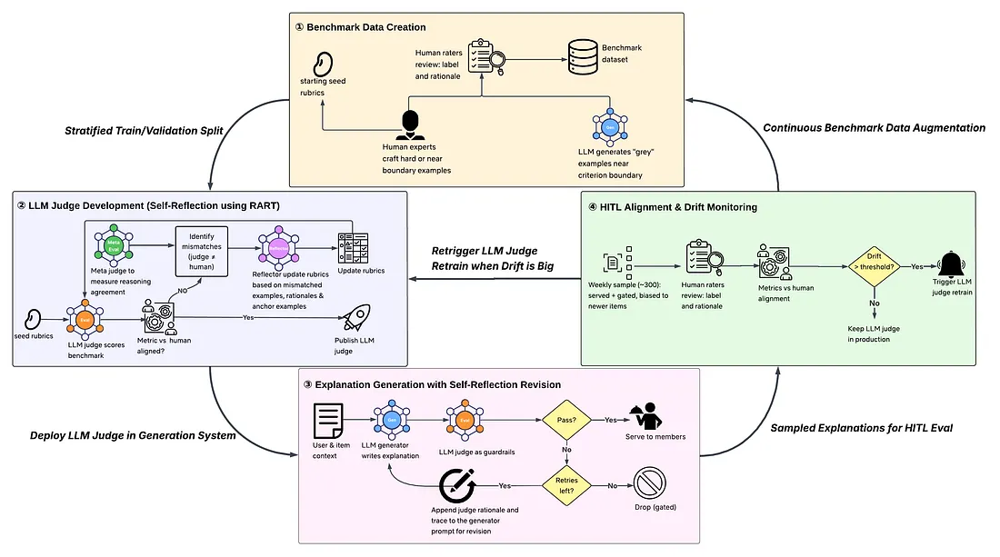
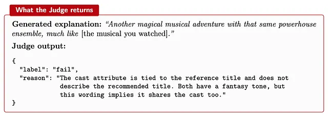
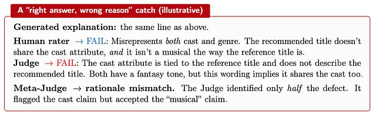
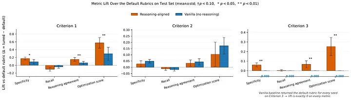

Sep 5, 2026
[원문 링크](https://netflixtechblog.com/the-lifecycle-of-llm-as-a-judge-building-aligning-and-monitoring-at-scale-c95bd8283508)

## Introduction

LLM으로 대규모 텍스트를 생성하는 팀이라면 누구나 같은 문제에 부딪힙니다. 모든 출력물을 사람이 직접 평가할 수는 없습니다. 
어떤 출력이 훌륭하고, 어떤 것이 평범하며, 어떤 것이 유해한지 알 수 없습니다. 단순히 그것들을 전부 읽어볼 수가 없기 때문입니다. 
이에 대한 표준적인 해법이 LLM-as-a-Judge, 즉 첫 번째 모델의 출력을 사람 평가자 대신(as a proxy for human raters) 채점해 주는 두 번째 모델입니다. 
이 방식은 빠르고, 저렴하며, 배포하기도 쉽습니다. 하지만 새롭고도 중대한 질문을 하나 낳습니다. 
*평가자는 누가 평가하는가?* 
게다가 판정기(Judge)가 드리프트를 일으켜, 조용히 성능이 저하되면서 나쁜 출력을 승인하기 시작하더라도, 그 뒤 단계에서는 어느 것도 이를 잡아내지 못합니다.

이 글은 저희가 이 문제를 어떻게 푸는지에 관한 이야기입니다. 
LLM 판정기를 구축하고, 정렬하고, 지속적으로 모니터링하여 시간이 지나도 계속 신뢰할 수 있게 유지하는 방법입니다. 
저희의 핵심 원칙은 단순합니다. LLM 판정기는 결코 홀로 작동해서는 안 됩니다. 
반드시 사람의 판단에 닻을 내리고 있어야 합니다. 저희는 라이프사이클의 모든 단계에 사람의 개입(human-in-the-loop, HITL)을 둡니다. 
사람이 "좋음"이 무엇인지 정의하고, 판정기를 학습, 검증하기 위한 라벨링된 벤치마크 데이터셋을 만들고, 시스템 안에서 판정기가 동작하는 동안 그 행동을 모니터링하며, 어떤 업데이트든 배포되기 전에 검토하고 승인합니다.

저희는 이렇게 믿습니다.

> **신뢰할 수 있는 LLM 판정기는 고정된 산출물이 아니다. 라이프사이클을 가진다.**

판정기는 신뢰할 수 있는 사람의 라벨을 기반으로 *구축되어야* 하고, 사람의 선호와 추론 방식에 맞게 *정렬되어야* 하며, 사람이 정한 정책 아래에서 *운영되어야* 하고, 데이터와 사용 패턴이 변함에 따라 계속 *유지보수되어야* 합니다. 
이 각 단계에는 사람 담당자가 있습니다. 아래 섹션에서는 이 네 단계와 각 단계의 핵심 설계 결정, 그리고 자체 LLM 판정기를 만들려는 팀에 전하고 싶은 교훈을 차례로 살펴봅니다. 
이 때 하나의 구체적인 과제를 글 전체를 관통하는 예시로 사용하는데, 바로 **추천 설명(recommendation explanation)**입니다.

**추천 설명**이란 추천된 작품에 함께 붙는 짧은 자연어 메시지로, 사용자가 추천 시스템을 어떻게 인식하고 얼마나 신뢰하는지에 영향을 줍니다. 
저희 서비스에서 설명이란 회원이 이전에 시청한 내용을 근거로 "왜 이 작품이 추천되었는지"를 사람이 읽을 수 있는 형태로 제시하는 것이며, 작품 상세 페이지에 표시됩니다. 
상세 페이지란 홈 화면에서 작품을 선택했을 때 도달하는 화면입니다. 
저희는 그중에서도 **유사도 기반 설명**에 집중합니다. 이는 추천된 작품을, 회원이 이전에 상호작용한 기준 작품 하나와 장르나 분위기 같은 공통 속성으로 연결해 주는 방식입니다. 예를 들면 다음과 같습니다.

> *사랑과 새로운 시작을 그린 유쾌하고 따뜻한 연말 로맨스, 「My Secret Santa」와 비슷한 작품입니다.*

여기서 품질이 중요한 이유는, 오해를 불러일으키거나 근거가 빈약한 설명은 설명이 쌓고자 했던 바로 그 신뢰를 오히려 무너뜨리기 때문입니다.

이어지는 모든 내용은 저희가 설명 기능을 대상으로 진행한 일련의 통제된 온라인 실험, 즉 실제 사용자에게 노출된 실험에서 나온 것입니다. 여기에는 Netflix 모바일 앱에서 한 달간 진행한 실험도 포함됩니다.
이 실험들에서 저희는 LLM으로 설명을 생성했는데, 끊임없이 바뀌는 카탈로그 전반에 걸쳐 매주 수십만 건에 달했습니다. 
이 규모를 사람이 직접 검토하는 것은 현실적으로 불가능했기에, 이를 평가할 두 번째 LLM을 배치했습니다.

무엇이 좋은 설명인지는 저희 과제에 특화된 문제입니다. 
하지만 설명을 평가하는 LLM 판정기를 구축하고, 정렬하고, 모니터링하는 방식 자체는 다른 과제에서도 재사용하고 일반화할 수 있어야 합니다.

Figure 1은 저희 LLM 판정기 라이프사이클의 네 단계와, 그 단계들을 잇는 데이터 흐름을 요약한 것입니다.

그림 1. LLM 판정기의 4단계 라이프사이클과 단계 사이를 오가는 데이터

출발점은 **탄생(Birth): 벤치마크 데이터 생성** 단계입니다. 
여기서는 사람 전문가가 **어렵거나 판단 경계에 가까운 예시를 직접** 만들고, 사람 평가자가 각 예시에 통과/실패 판정과 **그렇게 판단한 이유**를 글로 남깁니다. 
여기에 LLM이 생성한 회색 지대 예시를 보태어 더 풍부한 벤치마크 데이터셋을 구축합니다.

> 1) 어려운 예시를 만드는 이유?
> 명백히 좋은 설명과 명백히 나쁜 설명은 어떤 모델이든 맞히기 때문에 변별력이 없다.
> 판정기의 실력은 이게 통과인지 실패인지를 사람도 고민하는 경계 사례에서 드러난다.
> 그래서 무작위 샘플링이 아니라, 전문가가 경계 사례를 의도적으로 설계한다.
> 2) 라벨과 근거(이유)를 왜 같이 남길까?
> pass fail 라벨만 있으면 판정기의 정답률은 측정할 수 있지만, 틀렸을 때 왜 틀렸는지를 알 수 없다.
> 사람이 쓴 이유가 있으면, 두 가지 이점이 있다.
> 	- 판정가의 프롬프트에 기준으로 녹여 넣을 수 있다
> 	- 판정기가 낸 이유와 사람이 낸 이유를 비교해 결론은 맞았지만 잘못된 이유로 정답인 경우를 잡을 수 있다.
> 3) LLM으로 회색 지대 케이스를 만들어도 되는걸까?
> 사람이 경계 케이스를 직접 만드는 것은 한계가 있다. 절대적인 수량이 부족하기 때문이다.
> 그래서 LLM에 '이런 식으로 애매한 설명을 더 만들어라'라고 지시해서 양을 늘린다.
> 주의할 것은 이 예시의 라벨까지 LLM으로 붙이면 안 된다는 것이다.
> 예시 생성은 LLM이 도와도 되지만, pass fail 판정은 여전히 사람이 해야한다.

다음은 두 번째 단계인 **훈련(Training): LLM 판정기 개발**입니다. 
여기서는 탄생 단계에서 얻은 사람의 라벨과 판단 이유에 맞도록 LLM 판정기를 조정합니다. 
**자기 성찰(self-reflection)** 을 활용해 판정기와 사람 사이의 불일치를 찾아내고, 그 불일치와 기준 예시(anchor example)를 바탕으로 루브릭을 갱신합니다.
판정기가 사람 평가자와 충분히 정렬되었음을 지표가 보여줄 때까지 이 과정을 반복합니다.

세 번째 단계인 **배포(Deployment)** 에서는 판정기를 설명 생성 시스템에 통합하며, 판정기는 **관문(gate)이자 비평가(critic)** 의 역할을 동시에 맡습니다. 
LLM 생성기가 설명을 쓰면, LLM 판정기는 점수를 매겨 통과시키거나, 아니면 차단하면서 그 이유를 제공합니다. 
**생성기는 이 이유를 받아 스스로 고쳐 쓰고 다시 시도할 수 있습니다.** 
통과한 설명은 회원에게 노출되고, 품질이 낮은 설명은 관문에서 걸러집니다.

> Gate와 Critic의 차이
> Gate는 pass fail만 결정한다. Critic은 막은 이유를 생성 모델에게 돌려준다.
> 이 둘을 합치면 '생성 -> 판정 -> 거부 시 이유와 함께 재생성' 이라는 자동 루프가 된다.
> 품질 낮은 설명을 그냥 버리는 대신 고쳐서 살릴 수 있다.
> 설명이 없는 작품보다 설명이 있는 작품이 많아야 실험 효과를 측정할 수 있기 때문에, 실험 커버리지면에서도 중요하다.

마지막 단계는 **HITL 정렬 및 드리프트 모니터링**으로, 시간이 지나도 판정기가 사람과 정렬된 상태를 유지하도록 합니다. 
여기서 “human-in-the-loop”란 사람이 결정에 직접 관여한다는 뜻이지, 결과가 나온 뒤에 사후적으로 검토만 한다는 뜻이 아닙니다. 
저희는 훈련된 평가자(사람)를 기준으로 판정기를 벤치마크하며, 어떤 변경이든 시스템에 반영되기 전에 반드시 사람이 승인합니다.
저희는 매주 설명 표본을 추출(sampled)했습니다. 
표본에는 통과된 설명과 차단된 설명을 모두 넣되 신규 작품의 설명 비중을 높였습니다. 
사람 평가자가 이 표본을 검토해 라벨과 판단 이유를 달면, 저희는 그 결과와 판정기의 판단을 비교했습니다.
드리프트가 임계값을 넘으면 재훈련과 벤치마크 데이터 보강을 실행했습니다. 이렇게 새로 라벨링된 데이터와 갱신된 신호를 벤치마크 단계와 개발 단계로 다시 흘려보냄으로써 루프가 닫힙니다.

### **System components**

모든 단계에 걸쳐 네 가지 자동화 구성 요소가 등장하며, 이를 정의하고 검증하고 감독하는 사람의 역할이 함께합니다.

- **생성기(Generator)**: 설명 텍스트를 만듭니다. 수정 작업을 할 때는 판정기가 이전에 남긴 판단 이유와 기록(trace)을 프롬프트의 일부로 선택적으로 활용합니다.
- **판정기(Judge)**: 설명을 평가해 통과/실패 라벨과 함께 글로 된 판단 이유를 반환합니다. 배포된 파이프라인에서는 가드레일(나쁜 출력을 걸러내는 역할)과 비평가(스스로 고쳐 쓸 수 있도록 피드백을 주는 역할)를 동시에 맡습니다.
- **성찰기(Reflector)**: 판정기가 실수했을 때 판정기의 루브릭을 수정합니다. 불일치 예시, 사람의 판단 이유, 기준 예시(anchor example)를 바탕으로 루브릭을 갱신합니다. 루브릭을 조정하는 역할만 하며, 설명을 직접 평가하지는 않습니다.
- **메타 판정기(Meta-Judge)**: 판정기가 설명을 실패 처리했을 때 그 이유가 올바른지 확인합니다. 판정기의 판단 이유를 사람 평가자의 판단 이유와 비교하는 방식으로 이루어집니다.
- **사람 전문가와 평가자**: 품질 기준을 정의하는 전문가, 판정기를 조정하고 측정하는 기준이 되는 라벨과 판단 이유를 작성하는 평가자, 그리고 판정기가 동작하는 동안 이를 모니터링하고 변경 사항이 반영되기 전에 명시적으로 승인하는 검토자를 말합니다.

## Phase I, Birth: Establishing Ground Truth

이후의 모든 것은 "좋음"이 무엇인지 아는 데 달려 있으므로, 이 단계는 사람의 손이 가장 많이 가는 단계입니다. 
사내 글쓰기 전문가가 설명이 반드시 충족해야 할 필수 기준을 정의하고, 상세한 라벨링 가이드라인을 작성하며, 까다로운 적대적 예시를 직접 만듭니다. 
이 가이드라인은 두 가지 역할을 겸합니다. 
사람 평가자에게는 규정집이고, 나중에 조정할 LLM 판정기에게는 초기 루브릭입니다.

### 자체 벤치마크를 만든 이유

기성 LLM 판정기 벤치마크는 범용 텍스트 평가에 초점을 맞추고 있어, 저희 과제만의 특성을 담아내지 못합니다. 
설명은 짧고, 특정 작품에 묶여 있으며, 맥락에 의존합니다(각 설명은 대상 작품 하나와 회원이 시청한 기준 작품 한두 개에 연결되어 있습니다). 
또한 저희는 일반적인 언어 품질만이 아니라 **자체 편집 기준에 얼마나 부합하는지**도 중요하게 봅니다. 
그래서 서로 보완되는 세 가지 출처에서 자체 벤치마크를 구축했습니다.

- **전문가가 만든 적대적 사례**: 알려진 실패 유형을 담아 직접 작성한 통과/실패 예시입니다. 다른 어떤 방법으로도 안정적으로 얻기 어려운 종류의 경계 사례입니다.
- **경계 예시**: LLM이 합성한 설명으로, 통과/실패 경계 가까이로 일부러 밀어붙인 뒤 사람이 평가한 것입니다. 실제 트래픽에서 표본을 뽑아서는 좀처럼 드러나지 않는 애매한 사례를 포착합니다.
- **실제 표본 설명**: 테스트 실행 중 저희 LLM 생성기의 출력에서 표본으로 뽑은 설명입니다.

### Two details that mattered

- **벤치마크는 고정되어 있지 않습니다.** 모니터링 파이프라인(4단계)이 매주 사람이 평가한 새 설명 묶음을 벤치마크에 추가합니다. 덕분에 실험이 진행되는 동안 벤치마크는 낡아지지 않고 현재 카탈로그와 새로운 사용 패턴을 따라갔습니다.
- **모든 "실패" 라벨에는 왜 실패했는지를 설명하는 자유 서술형 판단 이유가 붙어 있습니다.** 사소한 기록 관리처럼 보이지만, 실제로는 다음 단계에 결정적입니다. 판정기의 추론을 조정하고 감사하는 데 쓰는 것이 바로 이 판단 이유이기 때문입니다.

## Phase II, Training: Aligning the Judge to Humans

### 실패 유형: 답은 맞는데 이유가 틀린 경우(The failure mode: right answer, wrong reason)

라벨 일치율 지표에는 전혀 드러나지 않는 실패 유형이 있습니다. 
판정기가 라벨에서는 사람과 일치하면서, 즉 사람이 통과시킬 것을 통과시키고 실패 처리할 것을 실패 처리하면서도, 그 결론에 틀린 이유로 도달할 수 있습니다. 
대시보드에서는 완벽하게 정렬된 것처럼 보입니다. 그러나 저희 파이프라인은 자기 수정(self-revision)을 이끌기 위해 실제로 거부 이유를 설명하라고 요청하는데, 이 순간 판정기가 잘못된 안내를 돌려줄 수 있습니다.

따라서 저희는 라벨 일치뿐 아니라 **추론 정렬(reasoning alignment)** 에도 신경 씁니다. 저희 구성에서 판정기는 항상 다음 두 가지를 출력하도록 되어 있습니다.

- **라벨**(예: PASS/FAIL)
- 그 라벨에 대한 짧은 **자연어 판단 이유**

예시를 하나 들어 보겠습니다. 회원이 뮤지컬을 한 편 봤습니다. 어린 여주인공이 등장하고 유명 배우들이 앙상블로 출연하는 가족 판타지입니다. 
저희는 어드벤처 영화 한 편을 추천했는데, 이 작품도 어린 여주인공이 나오는 가족 판타지이고, 추천 시스템이 두 작품을 짝지은 이유도 그것입니다. 
그러나 이 작품에는 노래도, 앙상블 출연진도 없습니다.

> 그림 번역)
> **생성된 추천 설명:** 그 강력한 앙상블 출연진이 그대로 돌아온 또 하나의 마법 같은 뮤지컬 어드벤처, [회원님이 시청한 뮤지컬]과 비슷한 작품입니다.
> **판정기 출력:**
> 라벨: 실패
> 이유: 출연진 속성은 기준 작품에 속한 것이지 추천 작품을 설명하는 것이 아닙니다. 두 작품 모두 판타지 분위기를 띠지만, 이 표현은 출연진까지 공유한다는 뜻을 담고 있습니다.

라벨(FAIL)은 맞고, 제시된 이유도 언뜻 보기에는 타당합니다. 그러나 아래에서 보이듯, 이 이유는 단순한 라벨 일치로는 잡아낼 수 없는 방식으로 불완전한 것으로 드러납니다.

> 보충설명) 생성기의 설명에는 공통점이 아닌 요소가 두 개 있다. 뮤지컬과 강력한 앙상블 출연진.
> 추천작품은 노래도 없고, 앙상블 출연진도 없다고 했으므로 오류다. 
> 그런데 판정기 출력을 보면 출연진만을 지적하고 뮤지컬이라는 장르 오류는 언급하지 않았다.
> 이것이 타당하지만 불완전한 판정기 출력 사례다.

### 추론 정렬 루브릭 조정(Reasoning-Aligned Rubric Tuning, RART)

저희는 각 기준의 LLM 판정기를 **추론 정렬 루브릭 조정(Reasoning-Aligned Rubric Tuning, RART)** 이라고 부르는 절차로 조정합니다. 
앞서 시스템 구성 요소에서 소개했듯, 판정기, 메타 판정기, 성찰기는 서로 다른 구성 요소입니다. 
판정기는 루브릭을 기준으로 설명에 점수를 매기고 판단 이유를 내놓으며, 메타 판정기는 그 판단 이유를 사람이 쓴 판단 이유와 비교하고, 성찰기는 루브릭 텍스트 자체를 고칩니다. 
RART는 이 셋을 하나의 훈련 루프로 묶는 방법입니다.

모든 판정기는 *루브릭*을 매개변수로 받는 고정된 프롬프트 템플릿이므로, 판정기를 조정한다는 것은 기반 모델을 다시 학습시킨다는 뜻이 아닙니다.
대신 판정기의 동작이 사람의 라벨 및 판단 이유와 일치할 때까지 *루브릭 텍스트*를 반복해서 다듬습니다.
$i$번째 반복에서 판정기는 현재 루브릭 텍스트를 조건으로 받아, 설명 하나를 라벨과 판단 이유의 쌍으로 대응시킵니다.

$$ J(R_i): x \mapsto (y_J(x), r_J(x))  $$

> 여기서 $R_i$는 현재 루브릭 텍스트, $y_J(x)$는 라벨, $r_J(x)$는 판단 이유입니다.

큰 틀에서 RART의 각 반복은 다음과 같이 진행됩니다.

1. 현재 루브릭으로 훈련 데이터를 채점합니다.
2. 별도로 떼어 둔(held-out) 검증 세트에서 가중 정렬 지표를 평가합니다. 기준별 지표가 모두 임계값을 넘으면 멈춥니다.
3. 그렇지 않으면, 정렬이 어긋난 예시들로 오류 기반 집중 세트(error-driven focus set)를 구성해 성찰기에 넘기고, 성찰기는 수정된 루브릭을 제안합니다.

일반적인 루프와의 핵심 차이는 "실수"를 어떻게 정의하느냐에 있습니다. 
대부분의 자기 개선 루프는 라벨 불일치만 봅니다. RART는 두 번째 종류의 오류를 추가합니다. 
메타 판정기는 **판정기와 사람이 모두 실패라고 판정한 사례**를 살펴보고, 판정기가 제시한 이유를 사람의 판단 이유와 비교합니다. 
둘이 갈라지면 그것이 "답은 맞는데 이유가 틀린" 오류이며, 이 역시 성찰기에 전달됩니다. 
구체적으로, 성찰기에 넘기는 집중 세트는 두 오류 집합의 합집합입니다.

- **라벨 불일치**: 판정기의 라벨이 사람의 라벨과 다른 예시.
- **라벨은 맞는데 이유가 틀린 경우**: 판정기와 사람이 모두 FAIL이라고 했지만, 메타 판정기가 보기에 두 판단 이유가 일치하지 않는 예시.

따라서 성찰기는 일반적인 라벨 오류와 "라벨은 맞는데 이유가 틀린" 오류 양쪽을 바탕으로 루브릭을 수정합니다. 이 두 번째 항이 RART의 핵심입니다. 
판정기는 사람의 결정과 일치하도록 떠밀릴 뿐 아니라, 메타 판정기가 사람의 추론과 정렬되었다고 인정할 만한 방식으로 그 결정을 정당화하도록 떠밀립니다.

앞의 예시로 돌아가면, LLM 판정기도 FAIL이라고 했고 사람도 FAIL이라고 했으므로, 라벨만 확인하는 방식에서는 일치로 기록됩니다. 
두 이유를 나란히 놓고 보면 그 확인 방식이 무엇을 놓치는지가 드러납니다.

> **생성된 설명**: 위와 같은 문장.
> **사람 평가자 → FAIL**: 출연진과 장르를 _모두_ 잘못 전달함. 추천 작품은 출연진 속성을 공유하지 않으며, _또한_ 기준 작품처럼 뮤지컬도 아님.
> 
> **판정기 → FAIL**: 출연진 속성은 기준 작품에 속한 것이지 추천 작품을 설명하는 것이 아님. 두 작품 모두 판타지 분위기를 띠지만, 이 표현은 출연진까지 공유한다는 뜻을 담고 있음.
> 
> **메타 판정기 → 판단 이유 불일치.** 판정기는 결함의 _절반_만 찾아냄. 출연진 주장은 지적했지만 "뮤지컬" 주장은 받아들임.

RART는 이 사례를 집중 세트로 보내며, 따라서 다음 루브릭 수정은 이 사례를 반영해야 합니다.

메타 판정기 역시 LLM이므로, 저희는 먼저 **메타 판정기를 사람과 대조해 검증** 했습니다. 
훈련된 사람 평가자가 양쪽 모두 실패로 판정한 판단 이유 쌍의 표본에 라벨을 붙였고, 메타 판정기는 그중 거의 전부에서 사람의 판정과 일치했습니다.

### Alignment metrics

저희는 **기준마다 판정기를 하나씩 운영** 하며, 각 판정기는 자기 루브릭을 갖고 독립적으로 조정되고 채점됩니다. 
그래서 아래의 모든 수치는 별도로 떼어 둔 데이터에서 기준별로 측정한 것입니다. 
각 기준에 대해 세 가지 지표를 추적합니다.

- **Specificity(특이도, fail-recall, 실패 재현율)**: 판정기가 나쁜 설명을 올바르게 거부하는 비율입니다. 저희가 가장 중시하는 지표인데, 관문을 빠져나간 나쁜 설명은 신뢰를 해칠 위험이 되기 때문입니다.
- **Recall(재현율, pass-recall, 통과 재현율)**: 좋은 설명을 올바르게 통과시키는 비율입니다. 이 수치가 높아야 커버리지가 유지되고 수정 비용이 낮아집니다.
- **Reasoning agreement(추론 일치율)**: 양쪽 모두 거부한 설명 가운데, 같은 이유로 거부한 비율입니다.

각 기준의 판정기는 저마다 이 세 지표를 갖고 있으며, 한 기준은 건강한데 다른 기준은 미끄러질 수 있습니다. 
관문이 엄격한 이유도 여기에 있습니다. 설명은 모든 필수 기준을 통과해야 노출 자격을 얻습니다.

> 보충설명) 
> 실패 재현율 = (사람 FAIL이고 판정기도 FAIL) / (사람 FAIL 전체)
> 통과 재현율 = (사람 PASS이고 판정기도 PASS) / (사람 PASS 전체)
> 실패 재현율과 통과 재현율은 서로 긴장 관계다. 
> 판정기를 엄격하게 만들면 실패 재현율은 오르지만 좋은 설명도 거부해 통과 재현율이 떨어진다.
> 느슨하게 만들면 반대가 된다. 
> 본문에서 실패 재현율을 가장 중시한다고 한 것은 여기서 어느쪽을 택할지 밝힌 것이다.

### 절제 실험: 추론 신호는 도움이 되는가?(Ablation: does the reasoning signal help?)

추론 신호의 영향을 분리해 보기 위해, RART를 다른 조건은 모두 같고 라벨 불일치만 사용하는 루프와 비교했습니다. 이 기준선을 **바닐라(vanilla)**라고 부릅니다. 성찰기도 같고, 판정기도 같고, 데이터도 같지만, 메타 판정기가 없고 사람의 판단 이유도 쓰지 않습니다.

그림 2. 준거별로 본 시작 루브릭 대비 개선 폭. 추론을 반영한 조정(RART)과 라벨만 쓰는 조정(바닐라)을 비교.

그림 2가 결과를 보여 줍니다. 세 필수 기준 중 둘에서는 바닐라와 RART가 같은 지점에 도달합니다. 
시작 루브릭이 이미 천장에 가까워 지표가 더 오를 여지가 거의 없었기 때문입니다. 

> 보충설명) 기준 1, 2는 오차 막대가 겹치므로 두 방법 간 차이 자체가 유의하지 않다는 것으로 보인다.

**세 번째 기준에서는 바닐라(라벨 전용) 방식이 퇴보(degrade)** 합니다. 
바닐라 루프의 성찰기는 루브릭을 퇴화된 형태로 고쳐 쓰고, 특이도와 추론 일치율은 반복할 때마다 떨어져 결국 출발점의 루브릭보다 나빠집니다. 
RART는 같은 기준에서 안정을 유지하며 두 지표를 모두 끌어올리고, 재현율도 소폭 개선합니다. 
그 이유는, 바닐라(라벨 전용) 최적화기는 건전하지 않은 추론으로도 맞는 라벨에 도달할 수 있는데, 건전하지 않은 추론은 새 데이터로 일반화되지 않기 때문입니다. 

> 보충설명) 성찰기에 주어지는 목표가 훈련 데이터의 라벨을 맞추라는 것 뿐이면, 성찰기는 라벨만 맞으면 어떤 규칙이든 루브릭에 넣는다.
> 그 규칙이 사람의 판단 기준과 무관한 피상적 패턴이어도 상관이 없다.

신호를 판단 이유에 닻 내리게 하면 그런 일이 방지됩니다. 
추론 정렬은 개선 여지가 있는 곳에서는 도움이 되고, 없는 곳에서는 해가 되지 않습니다.

