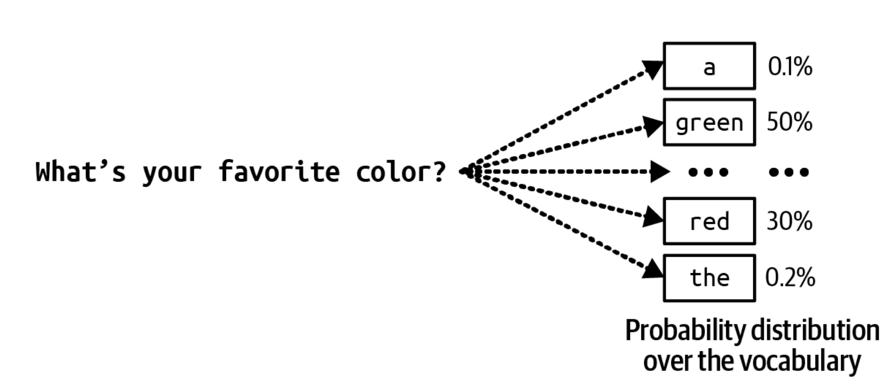
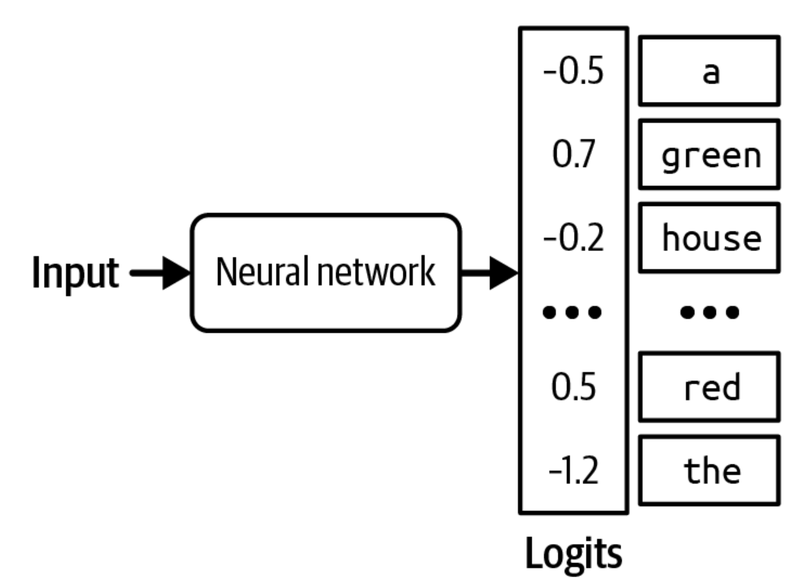
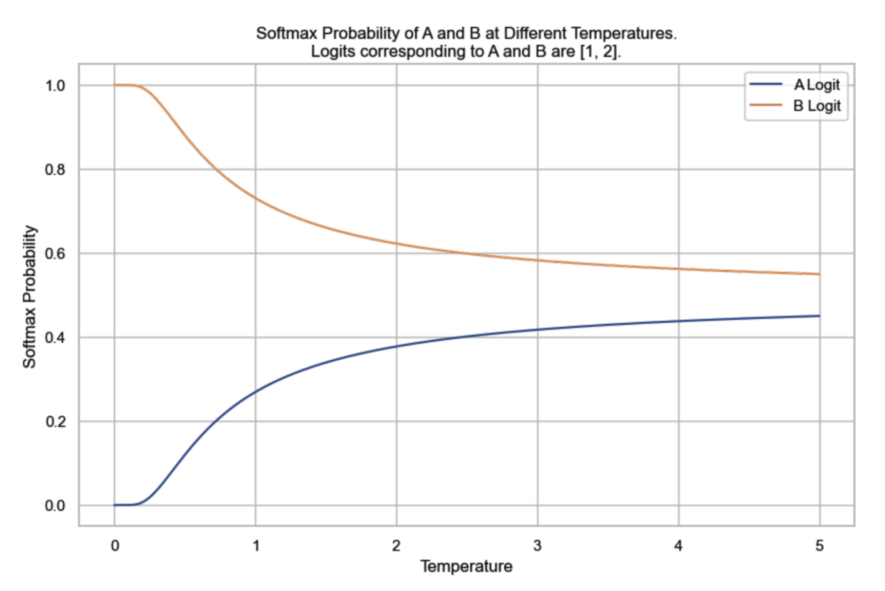
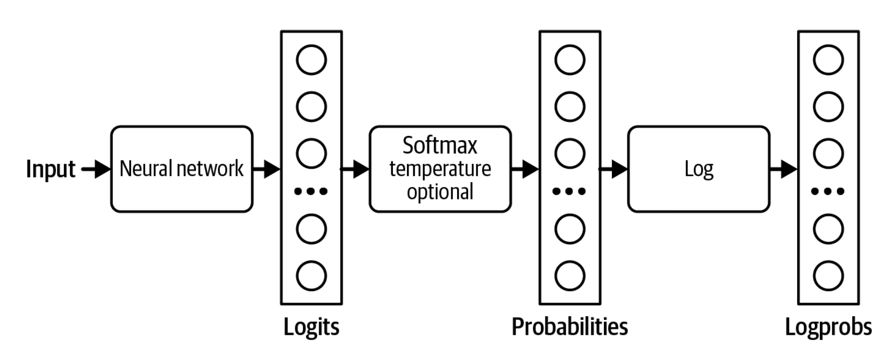

## Overview

모델은 샘플링(sampling)이라는 과정을 거쳐 출력을 만들어 낸다. 이 절에서는 여러 샘플링 전략과, temperature, top-k, top-p 같은 샘플링 변수를 다룬다. 
이어서 출력을 여러 개 샘플링해 모델의 성능을 높이는 방법을 살펴본다. 
또한 모델이 특정 형식과 제약을 따르는 응답을 생성하도록 샘플링 과정을 어떻게 바꿀 수 있는지도 알아본다.

샘플링 때문에 AI의 출력은 확률적이 된다. 이 확률적 성질을 이해하는 것은 AI의 행동, 예컨대 **일관성 없음** 이나 **환각(hallucination)** 을 다루는 데 중요하다. 
이 절은 이 확률적 성질이 무엇을 뜻하고 어떻게 대응해야 하는지를 깊이 파고들며 마무리한다.

## 2.4.1 샘플링의 기초(Sampling Fundamentals)

입력이 주어지면 신경망은 먼저 가능한 결과들의 확률을 계산하고, 그다음에 출력을 만든다. 
분류 모델이라면 가능한 결과는 분류 가능한 클래스들이다. 
예를 들어 어떤 이메일이 스팸인지 아닌지 분류하도록 훈련된 모델이라면, 가능한 결과는 "스팸"과 "스팸 아님" 둘뿐이다. 
모델은 이 두 결과 각각의 확률을 계산한다. 예컨대 이 이메일이 스팸일 확률은 90%, 스팸이 아닐 확률은 10%라는 식이다. 이렇게 나온 확률을 바탕으로 결정을 내릴 수 있다. 
가령 스팸 확률이 50%를 넘는 이메일은 모두 스팸으로 표시하기로 정했다면, 스팸 확률이 90%인 이메일은 스팸으로 표시된다.

언어 모델의 경우, 다음 토큰을 생성하려면 모델이 먼저 어휘(vocabulary)에 있는 모든 토큰에 대한 확률 분포를 계산한다. 이 분포는 그림 2-14와 같은 모양이다.

[**그림 2-14**] 다음 토큰을 생성하기 위해, 언어 모델은 먼저 어휘에 있는 모든 토큰에 대한 확률 분포를 계산한다.

확률이 서로 다른 여러 결과를 다룰 때 흔히 쓰는 전략은 확률이 가장 높은 결과를 고르는 것이다. 이렇게 항상 가장 가능성 높은 결과를 고르는 방식을 **탐욕적 샘플링(greedy sampling)** 이라고 한다. 
분류 작업에서는 이 방식이 잘 통하는 경우가 많다. 예를 들어 모델이 어떤 이메일을 스팸이 아닐 가능성보다 스팸일 가능성이 높다고 본다면, 그 메일을 스팸으로 표시하는 것이 타당하다.

하지만 언어 모델에서 탐욕적 샘플링을 쓰면 지루한 출력이 나온다. 무슨 질문을 하든 항상 가장 흔한 단어로만 대답하는 모델을 떠올려 보라.

항상 가장 가능성 높은 다음 토큰을 고르는 대신, 모델은 가능한 모든 값에 대한 확률 분포에 따라 다음 토큰을 샘플링할 수 있다. 그림 2-14처럼 “My favorite color is …”라는 문맥이 주어졌을 때, “red”가 다음 토큰이 될 확률이 30%이고 “green”이 50%라면, “red”는 전체의 30%에서, “green”은 50%에서 선택된다.

모델은 이런 확률을 어떻게 계산할까? 입력이 주어지면 신경망은 **로짓 벡터(logit vector)** 를 출력한다.
각 로짓은 가능한 값 하나에 대응한다. 언어 모델의 경우, 각 로짓은 모델 어휘에 있는 토큰 하나에 대응한다. 
따라서 로짓 벡터의 크기는 어휘의 크기와 같다. 로짓 벡터를 시각화한 것이 그림 2-15다.

[**그림 2-15**] 입력마다 언어 모델은 로짓 벡터를 하나 출력한다. 각 로짓은 어휘에 있는 토큰 하나에 대응한다.

로짓이 클수록 확률도 높기는 하지만, 로짓 자체가 확률을 나타내는 것은 아니다. 로짓은 전부 더해도 1이 되지 않는다. 
확률은 음수가 될 수 없는 반면, 로짓은 음수일 수도 있다. 
로짓을 확률로 바꾸기 위해 보통 소프트맥스(softmax) 층을 사용한다. 
모델의 어휘 크기가 $N$이고 로짓 벡터가 $[x_1, x_2, …, x_{N}]$이라고 하자. 
$i$번째 토큰의 확률 $p_i$는 다음과 같이 계산된다.

$$ p_i = \operatorname{softmax}(x_i) = \frac{\exp(x_i)}{\sum _j \exp(x_j)} $$

> Q) 왜 지수함수를 쓸까?
> 각 로짓을 전체 합으로 한다면? 합이 0이나 음수가 될 수 있다.
> 지수함수를 쓰면 이걸 해결하면서, 큰 값은 더 크게, 작은 값은 더 작게 차이를 만든다.

## 2.4.2 샘플링 전략(Sampling Strategies)

적절한 샘플링 전략을 사용하면, 모델이 애플리케이션에 더 잘 맞는 응답을 생성하게 만들 수 있다. 
예를 들어 어떤 샘플링 전략은 모델이 더 창의적인 응답을 생성하게 하고, 다른 전략은 생성 결과를 더 예측 가능하게 만든다. 
모델이 특정한 성질을 가진 응답을 내놓도록 슬쩍 유도하기(nudge) 위해 다양한 샘플링 전략이 제안되어 왔다. 
직접 샘플링 전략을 설계할 수도 있지만, 그러려면 보통 모델의 로짓에 접근할 수 있어야 한다. 
흔히 쓰이는 샘플링 전략 몇 가지를 살펴보며 어떻게 동작하는지 알아보자.

### 온도(Temperature)

확률 분포에 따라 다음 토큰을 샘플링할 때 생기는 문제 하나는, 모델이 덜 창의적일 수 있다는 점이다. 
앞의 예에서는 “red”, “green”, “purple” 같은 흔한 색이 가장 높은 확률을 가진다. 
그 결과 언어 모델의 답은 다음 문장처럼 다섯 살 아이가 말하는 것처럼 들린다. “My favorite color is green.” 
“the”의 확률은 낮기 때문에, “My favorite color is the color of a still lake on a spring morning(내가 가장 좋아하는 색은 봄날 아침 잔잔한 호수의 색이다)” 같은 창의적인 문장을 모델이 생성할 가능성은 낮다.[^1]

**가능한 값들의 확률을 다시 분배**하려면 온도(temperature)를 적용해 샘플링하면 된다. 
직관적으로 말해, **temperature를 높이면 흔한 토큰의 확률이 줄어들고, 그 결과 드문 토큰의 확률이 올라간다.** 이 덕분에 모델이 더 창의적인 응답을 만들어 낼 수 있다.

Temperature는 소프트맥스 변환 전에 로짓을 조정하는 데 쓰는 상수다. 로짓을 temperature로 나눈다. 
Temperature가 $T$일 때, $i$번째 토큰의 조정된 로짓은 $\frac{x_i}{T}$다. 
그런 다음 $x_i$ 대신 이 조정된 로짓에 소프트맥스를 적용한다.

Temperature가 확률에 미치는 영향을 간단한 예로 살펴보자. 
가능한 출력이 A와 B 둘뿐인 모델이 있다고 하자. 마지막 층에서 계산된 로짓은 $[1, 2]$다. 
즉 A의 로짓은 1, B의 로짓은 2다.

Temperature를 쓰지 않으면(이는 temperature를 1로 두는 것과 같다) 소프트맥스 확률은 $[0.27, 0.73]$이다. 모델은 전체의 73%에서 B를 고른다.

Temperature = 0.5이면 확률은 $[0.12, 0.88]$이 된다. 이제 모델은 전체의 88%에서 B를 고른다.

Temperature가 높을수록 모델이 가장 뻔한 값(로짓이 가장 큰 값)을 고를 가능성이 줄어들어, 모델의 출력이 더 창의적이 되지만 일관성은 떨어질 수 있다. 
Temperature가 낮을수록 모델이 가장 뻔한 값을 고를 가능성이 커져, 모델의 출력이 더 일관되지만 더 지루해질 수 있다.[^2]

그림 2-16은 여러 temperature에서 토큰 A와 B의 소프트맥스 확률을 보여 준다. Temperature가 0에 가까워질수록 모델이 토큰 B를 고를 확률은 1에 가까워진다. 

[**그림 2-16**] 로짓이 [1, 2]일 때, 여러 temperature에서 토큰 A와 B의 소프트맥스 확률. Temperature 값을 따로 설정하지 않으면(이는 temperature를 1로 두는 것과 같다) B의 소프트맥스 확률은 73%가 된다.

우리 예에서는 temperature가 0.1 미만이면 모델이 거의 항상 B를 출력한다. Temperature가 올라가면 토큰 A가 선택될 확률은 커지고 토큰 B가 선택될 확률은 작아진다. 
모델 제공업체는 보통 temperature를 0과 2 사이로 제한한다. 모델을 직접 보유하고 있다면 음수가 아닌 어떤 temperature든 쓸 수 있다. 
창의적인 용도에는 temperature 0.7이 자주 권장되는데, 창의성과 예측 가능성 사이에서 균형을 잡아 주기 때문이다. 
하지만 직접 실험해서 자기 상황에 가장 잘 맞는 temperature를 찾는 것이 좋다.

모델의 출력을 **더 일관되게 만들기 위해** temperature를 0으로 설정하는 것은 흔한 관행이다. 
엄밀히 말하면 temperature는 절대 0이 될 수 없다. 로짓을 0으로 나눌 수는 없기 때문이다. 
실제로는 temperature를 0으로 설정하면, 모델은 로짓 조정과 소프트맥스 계산을 하지 않고 **그냥 로짓이 가장 큰 토큰을 고른다.(greedy sampling)**[^3][^4]

> **팁**  
> AI 모델을 다룰 때 흔히 쓰는 디버깅 기법 하나는, **주어진 입력에 대해 모델이 계산한 확률을 들여다보는 것**이다. 
> 예를 들어 확률이 무작위처럼 보인다면 모델이 별로 학습된 것이 없다는 뜻이다.

많은 모델 제공업체는 모델이 생성한 확률을 [logprob](https://developers.openai.com/cookbook/examples/using_logprobs) 형태로 돌려준다. 
Logprob은 로그 확률(log probability)의 줄임말로, 로그 스케일로 표현한 확률이다. 
신경망의 확률을 다룰 때는 로그 스케일이 선호되는데, [언더플로(underflow)](https://en.wikipedia.org/wiki/Arithmetic_underflow) 문제를 줄이는 데 도움이 되기 때문이다. [^5]
언어 모델의 어휘 크기는 10만 개에 이르기도 하는데, 이는 많은 토큰의 확률이 너무 작아서 기계가 표현할 수 없을 정도가 될 수도 있다는 것을 의미한다.
이렇게 작은 수는 0으로 내림 처리될 수 있다. 로그 스케일은 이 문제를 줄여 준다.

그림 2-17은 로짓, 확률, logprob이 계산되는 흐름을 보여 준다.

[**그림 2-17**] 로짓, 확률, 로그프롭이 계산되는 과정

이 책 전체에서 보게 되겠지만, logprob은 애플리케이션을 만들 때(특히 분류 작업에서), 애플리케이션을 평가할 때, 그리고 모델이 내부에서 어떻게 동작하는지 이해할 때 유용하다. 
하지만 이 글을 쓰는 시점에 많은 모델 제공업체는 자사 모델의 logprob을 공개하지 않거나, 공개하더라도 logprob API에 제약을 두고 있다.[^6]
Logprob API에 제약을 두는 것은 보안상의 이유 때문일 가능성이 크다. 모델의 logprob이 공개되면 다른 사람이 그 모델을 복제하기가 더 쉬워지기 때문이다.

> 보충설명) '정답은 green'이라는 정보보다 'green 50%, red 30%, blue 15%...'라는 정보가 훨씬 풍부하기 때문에 증류하기 더 쉬워진다.

### top-k

Top-k는 모델 응답의 다양성을 크게 해치지 않으면서 계산량을 줄이기 위한 샘플링 전략이다. 가능한 모든 값에 대한 확률 분포를 계산하는 데 소프트맥스 층이 쓰인다는 점을 떠올려 보자. 
소프트맥스는 가능한 **모든 값을 두 번 훑어야 한다**. 한 번은 지수의 합 $\sum_j \exp(x_j)$를 구하기 위해, 또 한 번은 각 값에 대해 $\exp(x_i) / \sum_j \exp(x_j)$를 구하기 위해서다. 
어휘가 큰 언어 모델에서는 이 과정의 계산 비용이 크다.
이 문제를 피하기 위해, 모델이 로짓을 계산한 뒤 상위 k개의 로짓만 골라 그 k개에 대해서만 소프트맥스를 수행한다. 

> 보충설명) GPU에서 트랜스포머 본체 연산에 비하면 어휘 크기 10만 정도의 소프트맥스 자체는 비용이 미미하다. 
> 실제로 top-k의 진짜 역할은 계산 절약보다 저확률 토큰을 차단하는 것이다. temperature를 올리면 창의성이 올라가지만, 어휘 꼬리에 있는 말도 안 되는 토큰들의 확률도 함께 올라간다.
> 예를 들어 각각이 0.001%여도 수만개를 합치면 무시하지 못할 확률이 되기 때문에 엉뚱한 토큰이 튀어나온다. top-k는 이 꼬리를 통째로 자른다.
> temperature로 창의성을 올리고, tok-k로 안전망을 확보하는 셈이다.

> 보충설명2) 2018-2019년 당시 top-k가 제안된 시기에는 CPU 샘플링이나 작은 GPU 환경에서 모델을 구동하는 경우가 많았고, 어휘 전체에 대한 소프트맥스와 샘플링이 상대적으로 눈에 띄는 비용이었다.

애플리케이션에서 원하는 다양성의 정도에 따라 k는 50에서 500 사이 어디든 될 수 있는데, 이는 모델의 어휘 크기보다 훨씬 작은 수다. 그런 다음 모델은 이 상위 값들 중에서 샘플링한다. 
k가 작을수록 텍스트는 더 예측 가능해지지만 덜 흥미로워지는데, 모델이 고를 수 있는 단어가 유력한 단어 몇 개로 제한되기 때문이다.

[^1]: 역주) 원문은 'My favorite color is' 다음에 올 토큰을 예측하는 상황을 가정한다. 이때 'green'과 같은 단순한 색상 단어는 확률이 높지만, 'the color of a still lake on a spring morning'같이 창의적인 구절을 시작하는 'the'는 상대적으로 확률이 낮다. 따라서 확률이 가장 높은 토큰만 선택하는 방식으로는 창의적인 문장이 생성되기 어렵다는 점을 설명하고 있다.
[^2]: 꼭 과학적이라고 할 수는 없지만, 온도에 대해 필자가 떠올리는 그림은 더 높은 온도가 확률 분포를 더 혼란스럽게 만들고, 그 덕분에 낮은 확률의 토큰도 수면 위로 떠오른다는 것이다.
[^3]: [argmax 함수](https://en.wikipedia.org/wiki/Arg_max)를 수행한다.
[^4]: T=0이어도 출력이 항상 같지는 않다. argmax가 결정적이어도 그 앞의 로짓 계산 자체가 완벽힉 결정적이지 않기 때문이다. GPU의 부동소수점 연산은 그 순서에 따라 아주 미세하게 결과가 달라질 수 있어서, 두 토큰의 로짓이 거의 같으면 이 미세한 차이가 순위를 뒤집기도 한다.
[^5]: 언더플로 문제는 숫자가 주어진 형식우로 표현하기에 너무 작아서 0으로 내림되는 경우에 발생한다.
[^6]: 더 구체적으로 말하면, 이 글을 쓰는 시점에 OpenAI API는 가장 가능성이 높은 토큰 최대 20개까지만 [logprob](https://developers.openai.com/api/reference/resources/chat#chat-create-logprobs)을 보여준다. 예전에는 사용자가 제공한 임의의 텍스트에 대해 logprob을 받을 수 있었지만, 2023년 9월에 이 기능이 중단되었다(https://x.com/xuanalogue/status/1707757449900437984). Anthropic은 자사 모델의 logprob을 공개하지 않는다.