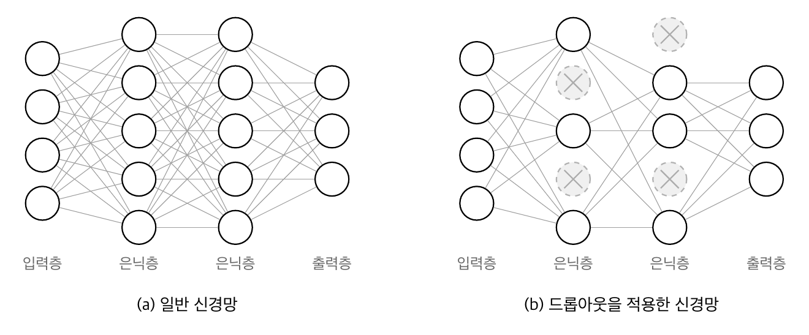
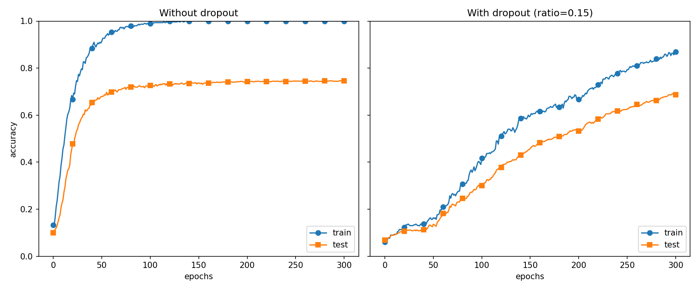

## Overview

머신러닝에서는 **과대적합**이 문제가 되는 일이 많다.
과대적합이란 신경망이 훈련 데이터에만 지나치게 적응되어 그 외의 데이터에는 제대로 대응하지 못하는 상태를 말한다.
과대적합은 매개변수가 많고 표현력이 높은 모델이거나, 훈련 데이터가 적을 때 주로 일어난다.
6.4절에서는 과대적합을 억제하는 기법으로 가중치 감소(weight decay)와 드롭아웃(dropout)을 다룬다. 이 노트는 그중 드롭아웃을 정리한다.

## 6.4.3 드롭아웃

가중치 감소는 간단하게 구현할 수 있고, 어느 정도 지나친 학습을 억제할 수 있다.
그러나 신경망 모델이 복잡해지면 가중치 감소만으로는 대응하기 어려워진다.
이럴때는 흔히 **드롭아웃(dropout)**이라는 기법을 이용한다.[^1]

드롭아웃은 뉴런을 임의로 삭제하면서 학습하는 방법이다.
훈련 때 은닉층의 뉴런을 무작위로 골라 삭제한다. 삭제된 뉴런은 Fig 6-22처럼 신호를 전달하지 않게 된다. 훈련 때는 데이터를 흘릴 때마다 삭제할 뉴런을 무작위로 선택하고, 시험 때는 모든 뉴런에 신호를 전달한다. 단, 시험 때는 각 뉴런의 출력에 훈련 때 삭제 안 한 비율을 곱해서 출력한다.



[**Fig6-22**] 드롭아웃의 개념: 왼쪽이 일반적인 신경망, 오른쪽이 드롭아웃을 적용한 신경망. 드롭아웃은 뉴런을 무작위로 선택해 삭제해서 신호 전달을 차단한다.

### 드롭아웃의 구현
이제 드롭아웃을 구현해보자. 다음 코드는 되도록 이해하기 쉽게 구현한 것이다.
순전파를 담당하는 `forward`메서드에서는 훈련 때(`train_flg=True`일 때)만 잘 계산해두면 시험 때는 단순히 데이터를 흘리기만 하면 된다.
삭제하지 않은 비율($1-r$)은 곱하지 않아도 좋다. 실제 딥러닝 프레임워크들도 비율을 곱하지 않는다.
더 효율적인 구현이 궁금하면 [Chainer 프레임워크](https://chainer.org)의 드롭아웃 구현을 참고하면 된다.

> 보충설명) **삭제 안 한 비율은 왜 곱해서 출력할까?** 다음 층이 받는 값의 크기를 동일하게 맞추기 위함이다. 다음 층의 가중치와 편향은 훈련할 때 들어온 값의 크기에 맞게 학습되었다. 
> 시험할 때 들어오는 값의 크기가 달라지면 학습한 가중치가 제대로 작동하지 않는다.
> 시험할 때 삭제하지 않은 비율을 곱하지 않으면, 훈련 때는 역수인 $1/(1-r)$를 곱해야 한다. 이를 inverted dropout이라고 한다. 
> 만약 둘 다 곱하지 않으면 훈련할 때보다 값이 층마다 드롭아웃 비율만큼 커진다. 
> 이 차이가 불러일으킬 수 있는 예시는 다음과 같다.
> ReLU에서 on off되는 뉴런이 바뀐다. (편향 항에 의해)
> Softmax의 입력이 커져서 확률이 극단적으로 쏠린다. 정확도보다 손실에 더 큰 영향을 준다.


```python
class Dropout:
	def __init__(self, dropout_ratio=0.5):
		self.dropout_ratio = dropout_ratio
		self.mask = None
	
	def forward(self, x, train_flg=True):
		if train_flg:
			# x.shape = (a, b) 일 때, *x.shape는 튜플을 풀어서 인자 여러 개로 넘긴다.
			# np.random.rand는 0이상 1미만 균등 분포 난수를 주어진 크기로 만든다.
			# > self.dropout_ratio는 배열 원소 하나씩 ratio보다 큰지 비교한다.
			self.mask = np.random.rand(*x.shape) > self.dropout_ratio
			# numpy는 곱셈에서 True를 1로, False를 0으로 계산한다.
			# 출력을 0으로 만들면 가중치가 얼마든 0이 되므로 뉴런 연결선을 지운 것과 같은 효과이다.
			return x * self.mask
		else:
			return x * (1.0 - self.dropout_ratio)
	
	def backward(self, dout):
		# 드롭아웃 계층의 순전파는 입력 x에 mask 값 m을 곱한 값이다. (y = xm)
		# 따라서 기울기는 마스크값이 된다. (dx = dout * m)
		# 결론적으로 삭제한 뉴런으로는 기울기가 흐르지 않아서, 연결된 가중치는 해당 데이터로 갱신되지 않는다.
		return dout * self.mask
```

여기서 핵심은 훈련 시에는 순전파 때마다 `self.mask`에 삭제할 뉴런을 `False`로 표시한다는 것이다. `self.mask`는 `x`와 형상이 같은 배열을 무작위로 생성하고, 그 값이 `dropout_ratio`보다 큰 원소만 `True`로 설정한다.
역전파 때의 동작은 `ReLU`와 같다. 
즉, 순전파 때 신호를 통과시키는 뉴런은 역전파 때도 신호를 그대로 통과시키고, 순전파 때 통과시키지 않은 뉴런은 역전파 때도 신호를 차단한다.

### MNIST로 드롭아웃 확인

드롭아웃의 효과를 MNIST 데이터셋으로 확인해보자. 소스코드에서는 `Trainer`라는 클래스를 이용해서 구현을 간소화했다.

> Note) common/trainer.py에는 `Trainer`라는 클래스를 구현했다. 이 클래스는 지금까지 해온 것과 같은 신경망 학습을 대신 해준다.

드롭아웃 실험은 앞의 실험과 마찬가지로 7층 신경망(각 층의 뉴런 수는 100개, 활성화 함수는 ReLU)을 써서 진행했다.
결과는 Fig 6-23과 같다.


[**Fig6-23**] 왼쪽은 드롭아웃 없이, 오른쪽은 드롭아웃을 적용한 결과(dropout_ratio=0.15)

드롭아웃을 적용하니 훈련 데이터와 시험 데이터에 대한 정확도 차이가 줄어들었다.
또, 훈련 데이터에 대한 정확도가 100%에 도달하지도 않게 되었다.
이처럼 드롭아웃을 이용하면 표현력을 높이면서도, 과대적합을 억제할 수 있다.

> Note) 머신러닝에서는 **앙상블 학습(ensemble learning)** 을 애용한다. 앙상블 학습은 개별적으로 학습시킨 여러 모델의 출력을 평균 내어 추론하는 방식이다.[^2]
> 신경망 맥락에서 얘기하면 가령 같은(혹은 비슷한) 구조의 신경망을 5개 준비하여 따로따로 학습시키고, 시험 때는 그 5개의 출력을 평균 내어 답하는 것이다.
> 앙상블 학습을 수행하면 신경망의 정확도가 몇%정도 개선된다는 사실이 실험적으로 알려져있다.
> 앙상블 학습은 드롭아웃과 밀접하다. 드롭아웃에서 학습 때 뉴런을 무작위로 삭제하는 행위를, 매번 다른 모델을 학습시키는 것으로 해석할 수 있기 때문이다.
> 그리고 추론 때는 뉴런의 출력에 삭제하지 않은 비율(ex. 0.5)을 곱함으로써 앙상블 학습에서 여러 모델의 평균을 낼 때와 같은 효과를 얻는 것이다.
> 즉, 드롭아웃은 앙상블 학습과 같은 효과를 (대략) 하나의 신경망으로 구현했다고 생각할 수 있다.

> Q&A) 앙상블 학습에 모델 K개를 쓴다고 하면, 추론할 때도 K배의 자원을 써야하는 것 아닌가?
> 비용 비싸지는 것은 맞는데, 그대로 K배 되지는 않음.

[^1]: N. Srivastava, G. Hinton, A Krizhevsky, I. Sutskever, and R. Salakhutdinov(2014): Dropout: A simple way to prevent neural networks from overfitting. The Journal of Machine Learning Research, pages 1929-1958, 2014.
[^2]: 역주. 평균 말고도 투표(voting) 등 다른 방법도 사용한다.
